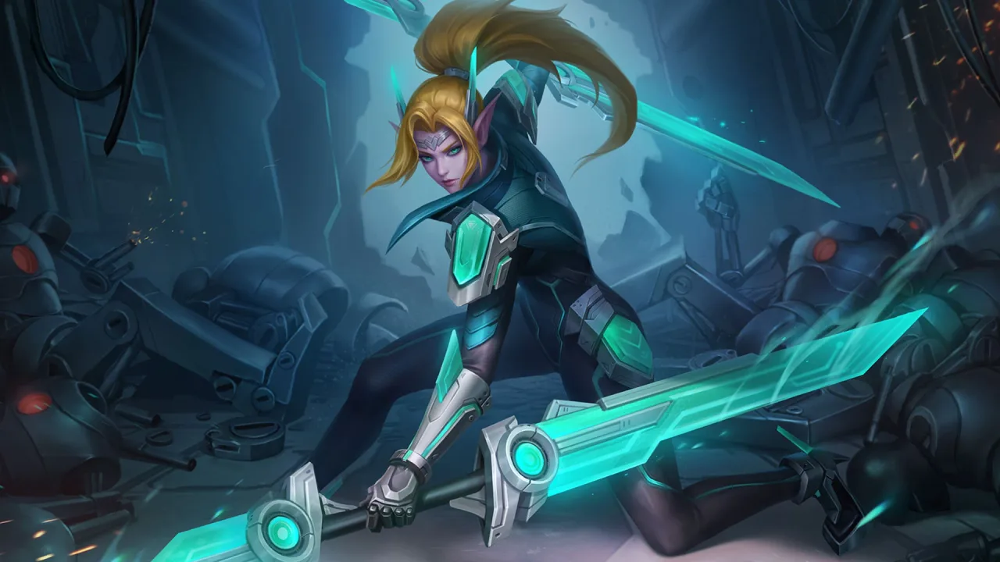

[Скины Карины](https://boostmlbb.ru/skins/karina.html)

[Скины](https://boostmlbb.ru/skins/)/[Карина](https://boostmlbb.ru/skins/karina.html)/Призрачный клинок

[Скин Карины](https://boostmlbb.ru/skins/karina.html)

# Призрачный клинок

Phantom Blade

Обычный CommonЭлитныйВ продаже

Как получить

Продаётся в магазине обликов за 399 алмазов.

Цена

399 алмазов

Вышел

2016 год

## Что меняет облик

-   Новая внешность
-   Бонус к характеристикам

## Все скины Карины [9](https://boostmlbb.ru/skins/karina.html)

[Чемпионка ключаОбычный · 2025](https://boostmlbb.ru/skins/karina/keyforged-champion.html)[Кровавая лунаОбычный · 2020](https://boostmlbb.ru/skins/karina/blood-moon.html)[Близнецы: СияниеДелюкс · 2019](https://boostmlbb.ru/skins/karina/gemini-halo.html)[ЛеонаГрандиозный · 2019](https://boostmlbb.ru/skins/karina/leona.html)[Роковая дуэлянткаИзысканный · 2018](https://boostmlbb.ru/skins/karina/doom-duelist.html)[Паучья лилияОбычный · 2018](https://boostmlbb.ru/skins/karina/spider-lily.html)[Чёрная жемчужинаИсключительный · 2017](https://boostmlbb.ru/skins/karina/black-pearl.html)[Рож­дественский карнавалИсключительный · 2016](https://boostmlbb.ru/skins/karina/christmas-carnival.html)[Призрачный клинокОбычный · 2016](https://boostmlbb.ru/skins/karina/phantom-blade.html)

## Серия «Элитный»

[Золотой османтусЧан'Э · 2026](https://boostmlbb.ru/skins/change/golden-osmanthus.html)[Король-воена­чальникМартис · 2025](https://boostmlbb.ru/skins/martis/warlord-king.html)[Кадет открытого моряКимми · 2024](https://boostmlbb.ru/skins/kimmy/high-seas-cadet.html)[Зелёная копейщицаСильвана · 2024](https://boostmlbb.ru/skins/silvanna/verdant-lancer.html)[Мародёр Кровавое КопытоХилос · 2024](https://boostmlbb.ru/skins/hylos/bloodhoof-marauder.html)[Изящная бабочкаГвиневра · 2024](https://boostmlbb.ru/skins/guinevere/elegant-butterfly.html)[Маркиз клинковЛанселот · 2024](https://boostmlbb.ru/skins/lancelot/marques-of-blades.html)[Привал в пустошахЧип · 2024](https://boostmlbb.ru/skins/chip/badlands-hiatus.html)

**Сколько стоит буст на герое Карина?**Выберите текущий и желаемый ранг. Стоимость появится на сайте.

[Рассчитать цену](https://boostmlbb.ru/order.html?type=hero)

## Частые вопросы

Как получить скин «Призрачный клинок» на Карину?

Продаётся в магазине обликов за 399 алмазов.

Когда вышел скин «Призрачный клинок»?

2016 год.

Какой класс у скина «Призрачный клинок»?

Обычный (Common), серия «Элитный».
