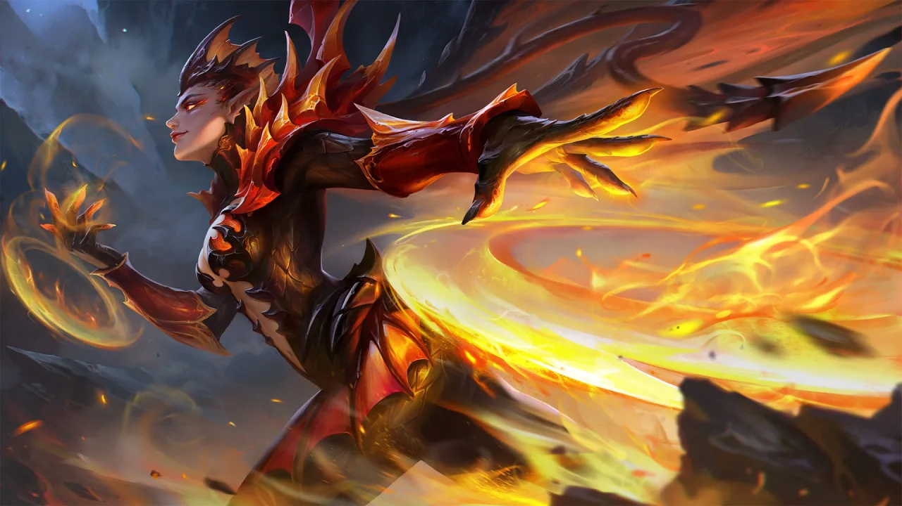
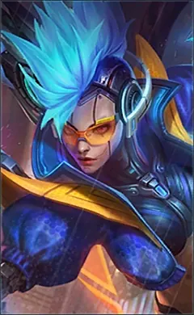

[Тир-лист](https://boostmlbb.ru/heroes/)[Предметы](https://boostmlbb.ru/items/)[Скины](https://boostmlbb.ru/skins/)[Новости и гайды](https://boostmlbb.ru/news/)

[Скины](https://boostmlbb.ru/skins/)/[Кэрри](https://boostmlbb.ru/skins/karrie.html)/Королева драконов

[Скин Кэрри](https://boostmlbb.ru/skins/karrie.html)

# Королева драконов

Dragon Queen

Исключительный ExceptionalЗвёздный участникОграниченный

Как получить

Награда «Звёздного участника» в январе 2018.

Вышел

1 января 2018

## Что меняет облик

-   Новая внешность
-   Новые эффекты навыков
-   Анимация показа
-   Бонус к характеристикам

## Все скины Кэрри [10](https://boostmlbb.ru/skins/karrie.html)

[Дыхание НаракиГрандиозный · 2025](https://boostmlbb.ru/skins/karrie/breath-of-naraka.html)[Ледяной коготьДелюкс · 2023](https://boostmlbb.ru/skins/karrie/ice-talon.html)[Колесо правосудияОбычный · 2021](https://boostmlbb.ru/skins/karrie/wheel-of-justice.html)[Неоновое колесоИзысканный · 2020](https://boostmlbb.ru/skins/karrie/neon-lightwheel.html)[Девушка-амфибияДелюкс · 2020](https://boostmlbb.ru/skins/karrie/gill-girl.html)[Ястребиный дозорИзысканный · 2019](https://boostmlbb.ru/skins/karrie/hawkwatch.html)[ШутихаИсключительный · 2018](https://boostmlbb.ru/skins/karrie/jester.html)[Королева драконовИсключительный · 2018](https://boostmlbb.ru/skins/karrie/dragon-queen.html)[Восходящая звездаОбычный · 2017](https://boostmlbb.ru/skins/karrie/rising-star.html)[Богомол с клинкамиОбычный · 2017](https://boostmlbb.ru/skins/karrie/bladed-mantis.html)

## Серия «Звёздный участник»

[Морячка, рождённая приливомКалеа · 2026](https://boostmlbb.ru/skins/kalea/tideborn-sailor.html)[Тень кицунэХаябуса · 2026](https://boostmlbb.ru/skins/hayabusa/kitsune-s-shadow.html)[Клыки резниХанзо · 2026](https://boostmlbb.ru/skins/hanzo/fangs-of-slaughter.html)[Тлеющая крепостьБелерик · 2026](https://boostmlbb.ru/skins/belerick/smouldering-fortress.html)[Магитех­нический призракОбсидия · 2026](https://boostmlbb.ru/skins/obsidia/magitech-wraith.html)[Элизийское сияниеЦзэтянь · 2026](https://boostmlbb.ru/skins/zetian/elysian-luminance.html)[Батальон стражейХильда · 2026](https://boostmlbb.ru/skins/hilda/guardian-battalion.html)[Мечта­тельный коиХарли · 2026](https://boostmlbb.ru/skins/harley/dreaming-koi.html)

**Поднимем ранг на герое Кэрри**Цена считается в калькуляторе

[Рассчитать цену](https://boostmlbb.ru/order.html?type=hero)

## Частые вопросы

Как получить скин «Королева драконов» на Кэрри?

Награда «Звёздного участника» в январе 2018.

Когда вышел скин «Королева драконов»?

1 января 2018.

Какой класс у скина «Королева драконов»?

Исключительный (Exceptional), серия «Звёздный участник».
