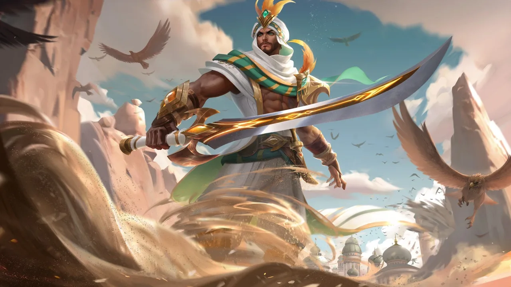

[Все скины](https://boostmlbb.ru/skins/)

[Скины](https://boostmlbb.ru/skins/)/Халид

# Скины Халида

Скинов

4

Можно купить

2

Последний

[Пустынная саламандра](https://boostmlbb.ru/skins/khaleed/desert-salamander.html)2025

[Профиль героя→](https://boostmlbb.ru/heroes/khaleed.html)

## Все скины

[Пустынная саламандраОбычный · 2025](https://boostmlbb.ru/skins/khaleed/desert-salamander.html)[Покоритель волнДелюкс · 2024](https://boostmlbb.ru/skins/khaleed/wave-strider.html)[Скимитар полумесяцаОбычный · 2021](https://boostmlbb.ru/skins/khaleed/crescent-scimitar.html)[Принц песковОбычный · 2020](https://boostmlbb.ru/skins/khaleed/prince-of-sand.html)

**Сколько стоит буст на герое Халид?**Выберите текущий и желаемый ранг. Стоимость появится на сайте.

[Рассчитать цену](https://boostmlbb.ru/order.html?type=hero)

## Частые вопросы

Сколько скинов у Халида?

4 скина без стандартного облика. Последний — «Пустынная саламандра» (Desert Salamander), 19 марта 2025.

Какие скины Халида можно купить сейчас?

«Покоритель волн» (899 алмазов), «Принц песков» (269 алмазов). Остальные облики ограниченные и возвращаются только в событиях.

Какой самый редкий скин Халида?

«Покоритель волн» (Wave Strider), класс делюкс, серия «Эпический». Продаётся в магазине обликов за 899 алмазов.
