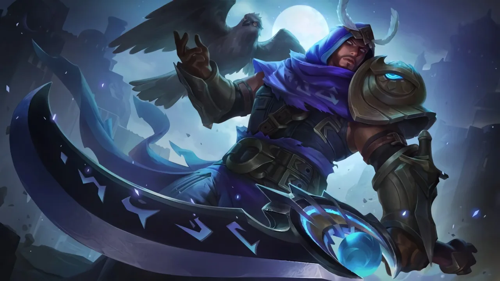
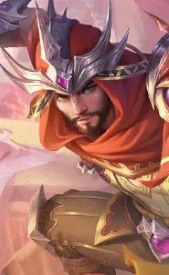

[Скины Халида](https://boostmlbb.ru/skins/khaleed.html)

[Скины](https://boostmlbb.ru/skins/)/[Халид](https://boostmlbb.ru/skins/khaleed.html)/Скимитар полумесяца

[Скин Халида](https://boostmlbb.ru/skins/khaleed.html)

# Скимитар полумесяца

Crescent Scimitar

Обычный CommonЭлитныйОграниченный

Как получить

Цена на старте: 599 алмазов. Сейчас в магазине не продаётся, возвращается только в событиях.

Цена

599 алмазов

Вышел

12 марта 2021

## Что меняет облик

-   Новая внешность
-   Другой цвет эффектов
-   Анимация показа
-   Бонус к характеристикам

## Все скины Халида [4](https://boostmlbb.ru/skins/khaleed.html)

[Пустынная саламандраОбычный · 2025](https://boostmlbb.ru/skins/khaleed/desert-salamander.html)[Покоритель волнДелюкс · 2024](https://boostmlbb.ru/skins/khaleed/wave-strider.html)[Скимитар полумесяцаОбычный · 2021](https://boostmlbb.ru/skins/khaleed/crescent-scimitar.html)[Принц песковОбычный · 2020](https://boostmlbb.ru/skins/khaleed/prince-of-sand.html)

## Серия «Элитный»

[Золотой османтусЧан'Э · 2026](https://boostmlbb.ru/skins/change/golden-osmanthus.html)[Король-воена­чальникМартис · 2025](https://boostmlbb.ru/skins/martis/warlord-king.html)[Кадет открытого моряКимми · 2024](https://boostmlbb.ru/skins/kimmy/high-seas-cadet.html)[Зелёная копейщицаСильвана · 2024](https://boostmlbb.ru/skins/silvanna/verdant-lancer.html)[Мародёр Кровавое КопытоХилос · 2024](https://boostmlbb.ru/skins/hylos/bloodhoof-marauder.html)[Изящная бабочкаГвиневра · 2024](https://boostmlbb.ru/skins/guinevere/elegant-butterfly.html)[Маркиз клинковЛанселот · 2024](https://boostmlbb.ru/skins/lancelot/marques-of-blades.html)[Привал в пустошахЧип · 2024](https://boostmlbb.ru/skins/chip/badlands-hiatus.html)

**Сколько стоит буст на герое Халид?**Выберите текущий и желаемый ранг. Стоимость появится на сайте.

[Рассчитать цену](https://boostmlbb.ru/order.html?type=hero)

## Частые вопросы

Как получить скин «Скимитар полумесяца» на Халида?

Цена на старте: 599 алмазов. Сейчас в магазине не продаётся, возвращается только в событиях.

Когда вышел скин «Скимитар полумесяца»?

12 марта 2021.

Какой класс у скина «Скимитар полумесяца»?

Обычный (Common), серия «Элитный».
