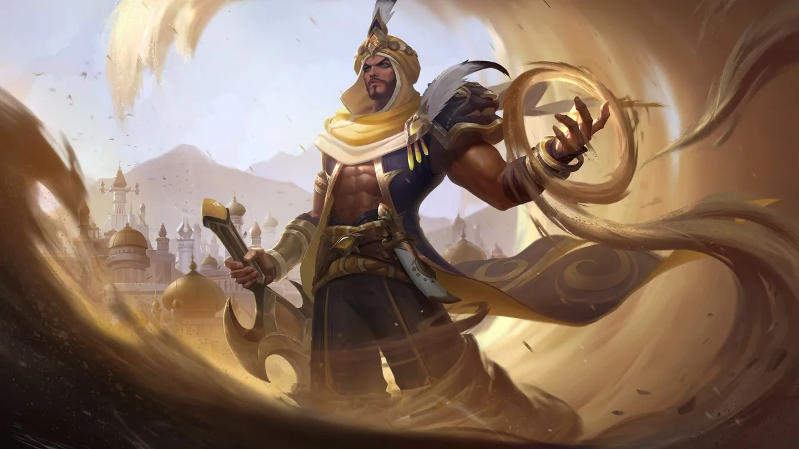

[Тир-лист](https://boostmlbb.ru/heroes/)[Предметы](https://boostmlbb.ru/items/)[Скины](https://boostmlbb.ru/skins/)[Новости и гайды](https://boostmlbb.ru/news/)

[Скины](https://boostmlbb.ru/skins/)/[Халид](https://boostmlbb.ru/skins/khaleed.html)/Принц песков

[Скин Халида](https://boostmlbb.ru/skins/khaleed.html)

# Принц песков

Prince of Sand

Обычный CommonВ продаже

Как получить

Продаётся в магазине обликов за 269 алмазов.

Цена

269 алмазов

Вышел

7 августа 2020

## Что меняет облик

-   Бонус к характеристикам

## Все скины Халида [4](https://boostmlbb.ru/skins/khaleed.html)

[Пустынная саламандраОбычный · 2025](https://boostmlbb.ru/skins/khaleed/desert-salamander.html)[Покоритель волнДелюкс · 2024](https://boostmlbb.ru/skins/khaleed/wave-strider.html)[Скимитар полумесяцаОбычный · 2021](https://boostmlbb.ru/skins/khaleed/crescent-scimitar.html)[Принц песковОбычный · 2020](https://boostmlbb.ru/skins/khaleed/prince-of-sand.html)

**Поднимем ранг на герое Халид**Цена считается в калькуляторе

[Рассчитать цену](https://boostmlbb.ru/order.html?type=hero)

## Частые вопросы

Как получить скин «Принц песков» на Халида?

Продаётся в магазине обликов за 269 алмазов.

Когда вышел скин «Принц песков»?

7 августа 2020.

Какой класс у скина «Принц песков»?

Обычный (Common).
