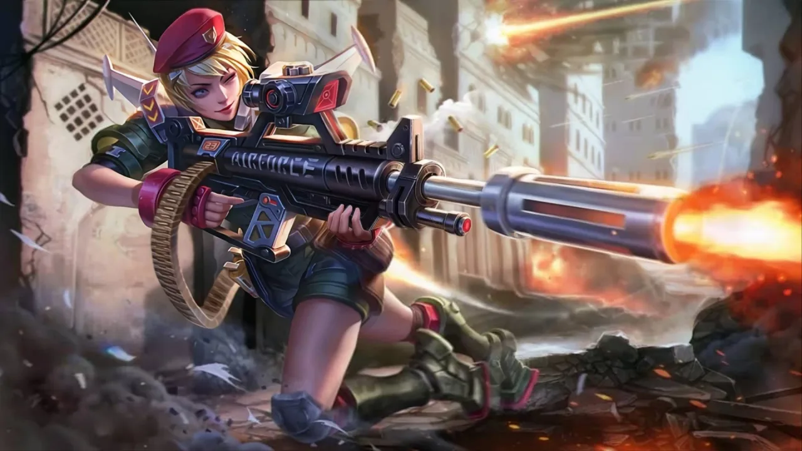

[Тир-лист](https://boostmlbb.ru/heroes/)[Предметы](https://boostmlbb.ru/items/)[Скины](https://boostmlbb.ru/skins/)[Новости и гайды](https://boostmlbb.ru/news/)

[Скины](https://boostmlbb.ru/skins/)/[Кимми](https://boostmlbb.ru/skins/kimmy.html)/Лидер атаки

[Скин Кимми](https://boostmlbb.ru/skins/kimmy.html)

# Лидер атаки

Charge Leader

Исключительный ExceptionalОсобыйВ продаже

Как получить

Продаётся в магазине обликов за 749 алмазов.

Цена

749 алмазов

Вышел

22 ноября 2018

## Что меняет облик

-   Новая внешность
-   Новые эффекты навыков
-   Анимация показа
-   Бонус к характеристикам

## Перекраски

Тот же облик в других цветах. Перекраска открывается, только если у вас уже есть сам облик.

-   **Сработавший запал** Detonated Fuse188 алмазов

## Все скины Кимми [9](https://boostmlbb.ru/skins/kimmy.html)

[Звёздный дозорный2026](https://boostmlbb.ru/skins/kimmy/starbound-sentry.html)[Морозное крылоДелюкс · 2025](https://boostmlbb.ru/skins/kimmy/frost-wing.html)[Восходящая сверхноваяИсключительный · 2025](https://boostmlbb.ru/skins/kimmy/rising-nova.html)[Кадет открытого моряОбычный · 2024](https://boostmlbb.ru/skins/kimmy/high-seas-cadet.html)[Реактивный штурмовик Первого орденаГрандиозный · 2023](https://boostmlbb.ru/skins/kimmy/first-order-jet-trooper.html)[Паровая исследова­тельницаОбычный · 2022](https://boostmlbb.ru/skins/kimmy/steam-researcher.html)[БиофронтирИсключительный · 2019](https://boostmlbb.ru/skins/kimmy/bio-frontier.html)[Лидер атакиИсключительный · 2018](https://boostmlbb.ru/skins/kimmy/charge-leader.html)[АстрокошкаИзысканный · 2018](https://boostmlbb.ru/skins/kimmy/astrocat.html)

## Серия «Особый»

[Тайный вердиктМатильда · 2026](https://boostmlbb.ru/skins/mathilda/arcane-verdict.html)[Вальс на ветруВэйл · 2026](https://boostmlbb.ru/skins/vale/windborne-waltz.html)[Капитан потерянныхФранко · 2026](https://boostmlbb.ru/skins/franco/captain-of-the-lost.html)[ВолнорезЛи Сун-Син · 2025](https://boostmlbb.ru/skins/yi-sun-shin/wavebreaker.html)[Стальные рукиБаданг · 2025](https://boostmlbb.ru/skins/badang/steel-arms.html)[Леди с зонтикомКагура · 2025](https://boostmlbb.ru/skins/kagura/lady-parasol.html)[Ужас пучиныАлдос · 2025](https://boostmlbb.ru/skins/aldous/fathom-terror.html)[Труппа лунного светаЧан'Э · 2025](https://boostmlbb.ru/skins/change/moonglow-troupe.html)

**Поднимем ранг на герое Кимми**Цена считается в калькуляторе

[Рассчитать цену](https://boostmlbb.ru/order.html?type=hero)

## Частые вопросы

Как получить скин «Лидер атаки» на Кимми?

Продаётся в магазине обликов за 749 алмазов.

Когда вышел скин «Лидер атаки»?

22 ноября 2018.

Какой класс у скина «Лидер атаки»?

Исключительный (Exceptional), серия «Особый».
