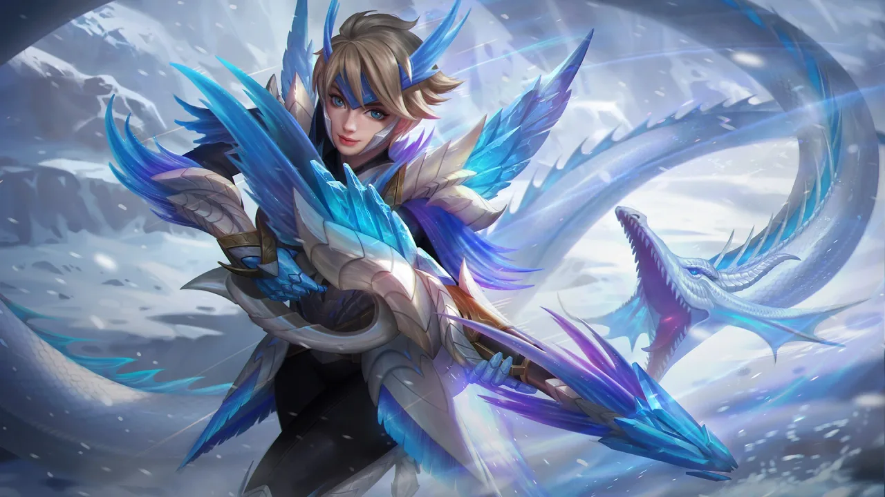

[Скины Кимми](https://boostmlbb.ru/skins/kimmy.html)

[Скины](https://boostmlbb.ru/skins/)/[Кимми](https://boostmlbb.ru/skins/kimmy.html)/Морозное крыло

[Скин Кимми](https://boostmlbb.ru/skins/kimmy.html)

# Морозное крыло

Frost Wing

Делюкс DeluxeУкротители драконовВ продаже

Как получить

Продаётся в магазине обликов за 899 алмазов.

Цена

899 алмазов

Вышел

3 апреля 2025

## Что меняет облик

-   Новая внешность
-   Новые эффекты навыков
-   Анимация показа
-   Сцена показа
-   Бонус к характеристикам

## Все скины Кимми [9](https://boostmlbb.ru/skins/kimmy.html)

[Звёздный дозорный2026](https://boostmlbb.ru/skins/kimmy/starbound-sentry.html)[Морозное крылоДелюкс · 2025](https://boostmlbb.ru/skins/kimmy/frost-wing.html)[Восходящая сверхноваяИсключительный · 2025](https://boostmlbb.ru/skins/kimmy/rising-nova.html)[Кадет открытого моряОбычный · 2024](https://boostmlbb.ru/skins/kimmy/high-seas-cadet.html)[Реактивный штурмовик Первого орденаГрандиозный · 2023](https://boostmlbb.ru/skins/kimmy/first-order-jet-trooper.html)[Паровая исследова­тельницаОбычный · 2022](https://boostmlbb.ru/skins/kimmy/steam-researcher.html)[БиофронтирИсключительный · 2019](https://boostmlbb.ru/skins/kimmy/bio-frontier.html)[Лидер атакиИсключительный · 2018](https://boostmlbb.ru/skins/kimmy/charge-leader.html)[АстрокошкаИзысканный · 2018](https://boostmlbb.ru/skins/kimmy/astrocat.html)

## Серия «Укротители драконов»

[Ночная теньЛинг · 2024](https://boostmlbb.ru/skins/ling/night-shade.html)[Небесное пламяЛанселот · 2021](https://boostmlbb.ru/skins/lancelot/empyrean-flame.html)[Драконья броняМаша · 2020](https://boostmlbb.ru/skins/masha/dragon-armor.html)[Драконье пламяВалир · 2019](https://boostmlbb.ru/skins/valir/draconic-flame.html)[Ротанговый драконЭстес · 2017](https://boostmlbb.ru/skins/estes/rattan-dragon.html)

**Сколько стоит буст на герое Кимми?**Выберите текущий и желаемый ранг. Стоимость появится на сайте.

[Рассчитать цену](https://boostmlbb.ru/order.html?type=hero)

## Частые вопросы

Как получить скин «Морозное крыло» на Кимми?

Продаётся в магазине обликов за 899 алмазов.

Когда вышел скин «Морозное крыло»?

3 апреля 2025.

Какой класс у скина «Морозное крыло»?

Делюкс (Deluxe), серия «Укротители драконов».
