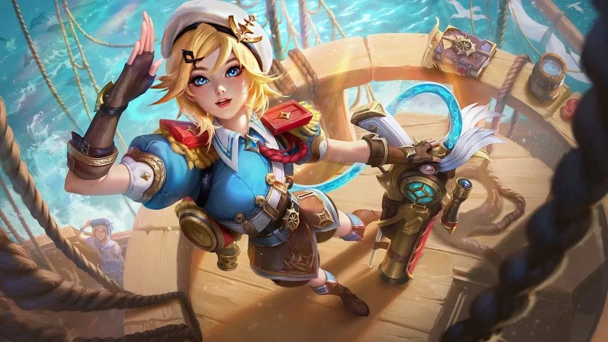

[Тир-лист](https://boostmlbb.ru/heroes/)[Предметы](https://boostmlbb.ru/items/)[Скины](https://boostmlbb.ru/skins/)[Новости и гайды](https://boostmlbb.ru/news/)

[Скины](https://boostmlbb.ru/skins/)/[Кимми](https://boostmlbb.ru/skins/kimmy.html)/Кадет открытого моря

[Скин Кимми](https://boostmlbb.ru/skins/kimmy.html)

# Кадет открытого моря

High Seas Cadet

Обычный CommonЭлитныйОграниченный

Как получить

Подарок за первое пополнение в сезоне 35.

Вышел

21 декабря 2024

## Что меняет облик

-   Новая внешность
-   Другой цвет эффектов
-   Анимация показа
-   Бонус к характеристикам

## Все скины Кимми [9](https://boostmlbb.ru/skins/kimmy.html)

[Звёздный дозорный2026](https://boostmlbb.ru/skins/kimmy/starbound-sentry.html)[Морозное крылоДелюкс · 2025](https://boostmlbb.ru/skins/kimmy/frost-wing.html)[Восходящая сверхноваяИсключительный · 2025](https://boostmlbb.ru/skins/kimmy/rising-nova.html)[Кадет открытого моряОбычный · 2024](https://boostmlbb.ru/skins/kimmy/high-seas-cadet.html)[Реактивный штурмовик Первого орденаГрандиозный · 2023](https://boostmlbb.ru/skins/kimmy/first-order-jet-trooper.html)[Паровая исследова­тельницаОбычный · 2022](https://boostmlbb.ru/skins/kimmy/steam-researcher.html)[БиофронтирИсключительный · 2019](https://boostmlbb.ru/skins/kimmy/bio-frontier.html)[Лидер атакиИсключительный · 2018](https://boostmlbb.ru/skins/kimmy/charge-leader.html)[АстрокошкаИзысканный · 2018](https://boostmlbb.ru/skins/kimmy/astrocat.html)

## Серия «Элитный»

[Золотой османтусЧан'Э · 2026](https://boostmlbb.ru/skins/change/golden-osmanthus.html)[Король-воена­чальникМартис · 2025](https://boostmlbb.ru/skins/martis/warlord-king.html)[Зелёная копейщицаСильвана · 2024](https://boostmlbb.ru/skins/silvanna/verdant-lancer.html)[Мародёр Кровавое КопытоХилос · 2024](https://boostmlbb.ru/skins/hylos/bloodhoof-marauder.html)[Изящная бабочкаГвиневра · 2024](https://boostmlbb.ru/skins/guinevere/elegant-butterfly.html)[Маркиз клинковЛанселот · 2024](https://boostmlbb.ru/skins/lancelot/marques-of-blades.html)[Привал в пустошахЧип · 2024](https://boostmlbb.ru/skins/chip/badlands-hiatus.html)[Звёздный фокусникХарли · 2024](https://boostmlbb.ru/skins/harley/star-magician.html)

**Поднимем ранг на герое Кимми**Цена считается в калькуляторе

[Рассчитать цену](https://boostmlbb.ru/order.html?type=hero)

## Частые вопросы

Как получить скин «Кадет открытого моря» на Кимми?

Подарок за первое пополнение в сезоне 35.

Когда вышел скин «Кадет открытого моря»?

21 декабря 2024.

Какой класс у скина «Кадет открытого моря»?

Обычный (Common), серия «Элитный».
