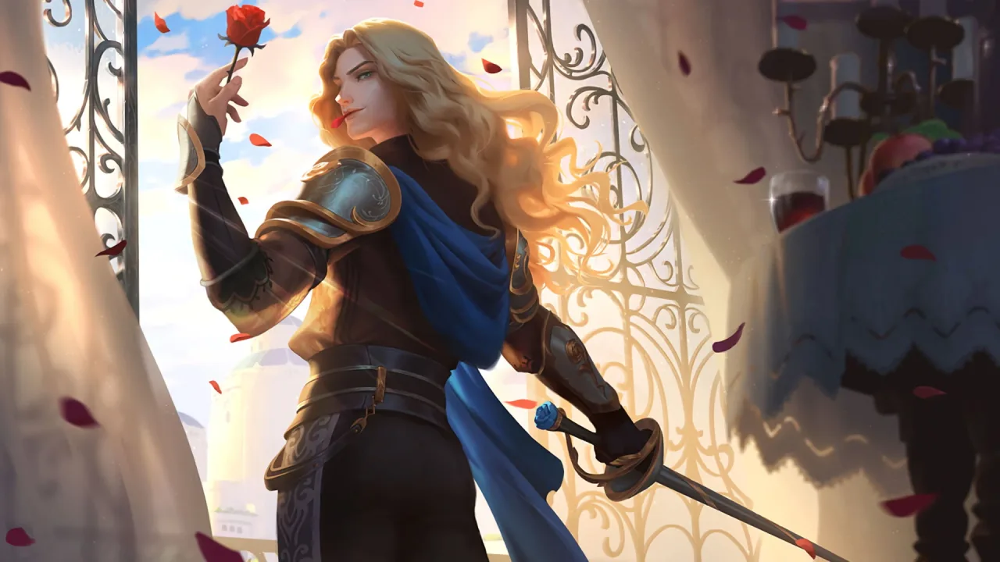

[Тир-лист](https://boostmlbb.ru/heroes/)[Предметы](https://boostmlbb.ru/items/)[Скины](https://boostmlbb.ru/skins/)[Новости и гайды](https://boostmlbb.ru/news/)

[Скины](https://boostmlbb.ru/skins/)/Ланселот

# Скины Ланселота

Скинов

12

Можно купить

3

Последний

[Клинок предан­ности](https://boostmlbb.ru/skins/lancelot/blade-of-devotion.html)2026

[Профиль героя→](https://boostmlbb.ru/heroes/lancelot.html)

## Все скины

ВсеГрандиозныйИзысканныйДелюксИсключительныйОбычный

[Клинок предан­ностиИзысканный · 2026](https://boostmlbb.ru/skins/lancelot/blade-of-devotion.html)[Страж святилищаГрандиозный · 2025](https://boostmlbb.ru/skins/lancelot/guardian-of-the-shrine.html)[Мастер мечаГрандиозный · 2024](https://boostmlbb.ru/skins/lancelot/swordmaster.html)[Маркиз клинковОбычный · 2024](https://boostmlbb.ru/skins/lancelot/marques-of-blades.html)[Небесное пламяДелюкс · 2021](https://boostmlbb.ru/skins/lancelot/empyrean-flame.html)[Bren EsportsДелюкс · 2020](https://boostmlbb.ru/skins/lancelot/bren-esports.html)[Цветочный рыцарьДелюкс · 2019](https://boostmlbb.ru/skins/lancelot/floral-knight.html)[РыбыДелюкс · 2019](https://boostmlbb.ru/skins/lancelot/pisces.html)[Коро­левский матадорИзысканный · 2018](https://boostmlbb.ru/skins/lancelot/royal-matador.html)[Тёмный графИсключительный · 2018](https://boostmlbb.ru/skins/lancelot/dark-earl.html)[Рож­дественский карнавалИсключительный · 2018](https://boostmlbb.ru/skins/lancelot/christmas-carnival.html)[Рыцарь в маскеОбычный · 2018](https://boostmlbb.ru/skins/lancelot/masked-knight.html)

**Поднимем ранг на герое Ланселот**Цена считается в калькуляторе

[Рассчитать цену](https://boostmlbb.ru/order.html?type=hero)

## Частые вопросы

Сколько скинов у Ланселота?

12 скинов без стандартного облика. Последний — «Клинок преданности» (Blade of Devotion), 1 февраля 2026.

Какие скины Ланселота можно купить сейчас?

«Небесное пламя» (899 алмазов), «Цветочный рыцарь» (899 алмазов), «Рыцарь в маске» (269 алмазов). Остальные облики ограниченные и возвращаются только в событиях.

Какой самый редкий скин Ланселота?

«Страж святилища» (Guardian of the Shrine), класс грандиозный, серия «Кисин дэнсэцу». Выходил в событии «Кисин дэнсэцу». Ограниченные облики иногда возвращаются в розыгрышах событий.
