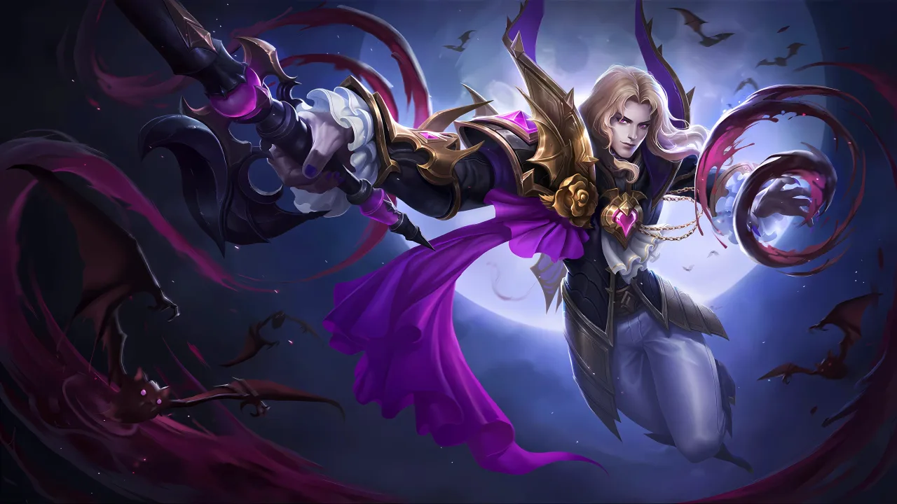

[Тир-лист](https://boostmlbb.ru/heroes/)[Предметы](https://boostmlbb.ru/items/)[Скины](https://boostmlbb.ru/skins/)[Новости и гайды](https://boostmlbb.ru/news/)

[Скины](https://boostmlbb.ru/skins/)/[Ланселот](https://boostmlbb.ru/skins/lancelot.html)/Тёмный граф

[Скин Ланселота](https://boostmlbb.ru/skins/lancelot.html)

# Тёмный граф

Dark Earl

Исключительный ExceptionalЗвёздный участникОграниченный

Как получить

Награда «Звёздного участника» в августе 2018.

Вышел

1 августа 2018

## Что меняет облик

-   Новая внешность
-   Новые эффекты навыков
-   Анимация показа
-   Бонус к характеристикам

## Все скины Ланселота [12](https://boostmlbb.ru/skins/lancelot.html)

[Клинок предан­ностиИзысканный · 2026](https://boostmlbb.ru/skins/lancelot/blade-of-devotion.html)[Страж святилищаГрандиозный · 2025](https://boostmlbb.ru/skins/lancelot/guardian-of-the-shrine.html)[Мастер мечаГрандиозный · 2024](https://boostmlbb.ru/skins/lancelot/swordmaster.html)[Маркиз клинковОбычный · 2024](https://boostmlbb.ru/skins/lancelot/marques-of-blades.html)[Небесное пламяДелюкс · 2021](https://boostmlbb.ru/skins/lancelot/empyrean-flame.html)[Bren EsportsДелюкс · 2020](https://boostmlbb.ru/skins/lancelot/bren-esports.html)[Цветочный рыцарьДелюкс · 2019](https://boostmlbb.ru/skins/lancelot/floral-knight.html)[РыбыДелюкс · 2019](https://boostmlbb.ru/skins/lancelot/pisces.html)[Коро­левский матадорИзысканный · 2018](https://boostmlbb.ru/skins/lancelot/royal-matador.html)[Тёмный графИсключительный · 2018](https://boostmlbb.ru/skins/lancelot/dark-earl.html)[Рож­дественский карнавалИсключительный · 2018](https://boostmlbb.ru/skins/lancelot/christmas-carnival.html)[Рыцарь в маскеОбычный · 2018](https://boostmlbb.ru/skins/lancelot/masked-knight.html)

## Серия «Звёздный участник»

[Морячка, рождённая приливомКалеа · 2026](https://boostmlbb.ru/skins/kalea/tideborn-sailor.html)[Тень кицунэХаябуса · 2026](https://boostmlbb.ru/skins/hayabusa/kitsune-s-shadow.html)[Клыки резниХанзо · 2026](https://boostmlbb.ru/skins/hanzo/fangs-of-slaughter.html)[Тлеющая крепостьБелерик · 2026](https://boostmlbb.ru/skins/belerick/smouldering-fortress.html)[Магитех­нический призракОбсидия · 2026](https://boostmlbb.ru/skins/obsidia/magitech-wraith.html)[Элизийское сияниеЦзэтянь · 2026](https://boostmlbb.ru/skins/zetian/elysian-luminance.html)[Батальон стражейХильда · 2026](https://boostmlbb.ru/skins/hilda/guardian-battalion.html)[Мечта­тельный коиХарли · 2026](https://boostmlbb.ru/skins/harley/dreaming-koi.html)

**Поднимем ранг на герое Ланселот**Цена считается в калькуляторе

[Рассчитать цену](https://boostmlbb.ru/order.html?type=hero)

## Частые вопросы

Как получить скин «Тёмный граф» на Ланселота?

Награда «Звёздного участника» в августе 2018.

Когда вышел скин «Тёмный граф»?

1 августа 2018.

Какой класс у скина «Тёмный граф»?

Исключительный (Exceptional), серия «Звёздный участник».
