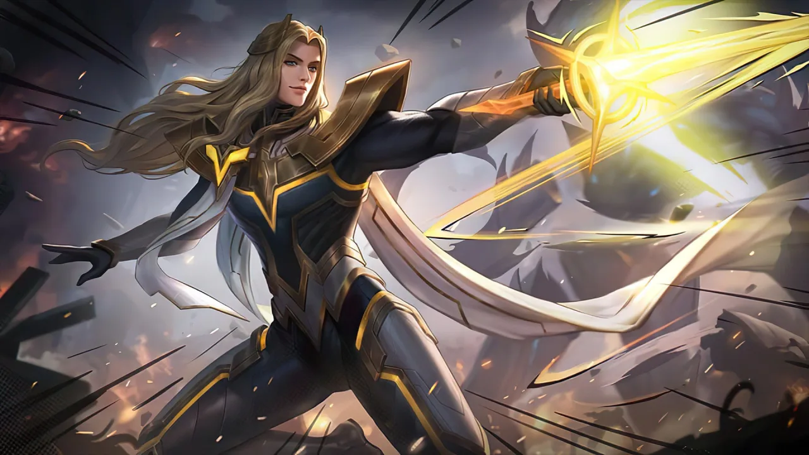
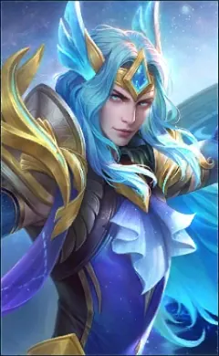

[Скины Ланселота](https://boostmlbb.ru/skins/lancelot.html)

[Скины](https://boostmlbb.ru/skins/)/[Ланселот](https://boostmlbb.ru/skins/lancelot.html)/Мастер меча

[Скин Ланселота](https://boostmlbb.ru/skins/lancelot.html)

# Мастер меча

Swordmaster

Грандиозный GrandВосходящие звёздыОграниченный

Как получить

Выходил в событии «Восходящие звёзды». Ограниченные облики иногда возвращаются в розыгрышах событий.

Вышел

5 марта 2024

## Что меняет облик

-   Новая внешность
-   Новые эффекты навыков
-   Звуки навыков
-   Своя озвучка
-   Анимация показа
-   Сцена показа
-   Бонус к характеристикам

## Все скины Ланселота [12](https://boostmlbb.ru/skins/lancelot.html)

[Клинок предан­ностиИзысканный · 2026](https://boostmlbb.ru/skins/lancelot/blade-of-devotion.html)[Страж святилищаГрандиозный · 2025](https://boostmlbb.ru/skins/lancelot/guardian-of-the-shrine.html)[Мастер мечаГрандиозный · 2024](https://boostmlbb.ru/skins/lancelot/swordmaster.html)[Маркиз клинковОбычный · 2024](https://boostmlbb.ru/skins/lancelot/marques-of-blades.html)[Небесное пламяДелюкс · 2021](https://boostmlbb.ru/skins/lancelot/empyrean-flame.html)[Bren EsportsДелюкс · 2020](https://boostmlbb.ru/skins/lancelot/bren-esports.html)[Цветочный рыцарьДелюкс · 2019](https://boostmlbb.ru/skins/lancelot/floral-knight.html)[РыбыДелюкс · 2019](https://boostmlbb.ru/skins/lancelot/pisces.html)[Коро­левский матадорИзысканный · 2018](https://boostmlbb.ru/skins/lancelot/royal-matador.html)[Тёмный графИсключительный · 2018](https://boostmlbb.ru/skins/lancelot/dark-earl.html)[Рож­дественский карнавалИсключительный · 2018](https://boostmlbb.ru/skins/lancelot/christmas-carnival.html)[Рыцарь в маскеОбычный · 2018](https://boostmlbb.ru/skins/lancelot/masked-knight.html)

## Серия «Восходящие звёзды»

[Снежная буряВэйл · 2023](https://boostmlbb.ru/skins/vale/blizzard-storm.html)[Прорица­тельницаЭсмеральда · 2023](https://boostmlbb.ru/skins/esmeralda/the-foreseer.html)[Громовой кулакЧу · 2021](https://boostmlbb.ru/skins/chou/thunderfist.html)[Огненный разрядБруно · 2020](https://boostmlbb.ru/skins/bruno/firebolt.html)

**Сколько стоит буст на герое Ланселот?**Выберите текущий и желаемый ранг. Стоимость появится на сайте.

[Рассчитать цену](https://boostmlbb.ru/order.html?type=hero)

## Частые вопросы

Как получить скин «Мастер меча» на Ланселота?

Выходил в событии «Восходящие звёзды». Ограниченные облики иногда возвращаются в розыгрышах событий.

Когда вышел скин «Мастер меча»?

5 марта 2024.

Какой класс у скина «Мастер меча»?

Грандиозный (Grand), серия «Восходящие звёзды».
