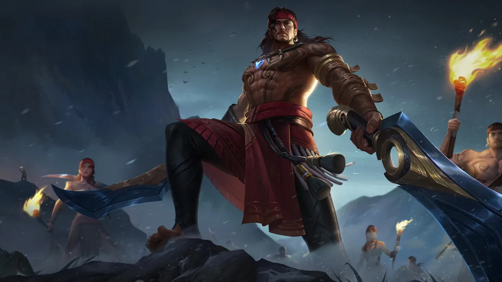

[Тир-лист](https://boostmlbb.ru/heroes/)[Предметы](https://boostmlbb.ru/items/)[Скины](https://boostmlbb.ru/skins/)[Новости и гайды](https://boostmlbb.ru/news/)

[Скины](https://boostmlbb.ru/skins/)/Лапу-Лапу

# Скины Лапу-Лапу

Скинов

6

Можно купить

2

Последний

[Избранник Адлау](https://boostmlbb.ru/skins/lapu-lapu/adlaw-s-chosen.html)2024

[Профиль героя→](https://boostmlbb.ru/heroes/lapu-lapu.html)

## Все скины

[Избранник АдлауИзысканный · 2024](https://boostmlbb.ru/skins/lapu-lapu/adlaw-s-chosen.html)[Сын дикой природыОбычный · 2022](https://boostmlbb.ru/skins/lapu-lapu/son-of-the-wild.html)[СпецназИсключительный · 2021](https://boostmlbb.ru/skins/lapu-lapu/special-force.html)[ВулканИсключительный · 2019](https://boostmlbb.ru/skins/lapu-lapu/vulcan.html)[Клинок предковОбычный · 2017](https://boostmlbb.ru/skins/lapu-lapu/ancestral-blade.html)[Имперский чемпионОбычный · 2017](https://boostmlbb.ru/skins/lapu-lapu/imperial-champion.html)

**Поднимем ранг на герое Лапу-Лапу**Цена считается в калькуляторе

[Рассчитать цену](https://boostmlbb.ru/order.html?type=hero)

## Частые вопросы

Сколько скинов у Лапу-Лапу?

6 скинов без стандартного облика. Последний — «Избранник Адлау» (Adlaw's Chosen), январь 2024.

Какие скины Лапу-Лапу можно купить сейчас?

«Клинок предков» (269 алмазов), «Имперский чемпион» (599 алмазов). Остальные облики ограниченные и возвращаются только в событиях.

Какой самый редкий скин Лапу-Лапу?

«Избранник Адлау» (Adlaw's Chosen), класс изысканный, серия «Коллекционный». Главный приз розыгрыша в коллекционном событии, попытки покупаются за алмазы. Ограниченные облики иногда возвращаются в розыгрышах событий.
