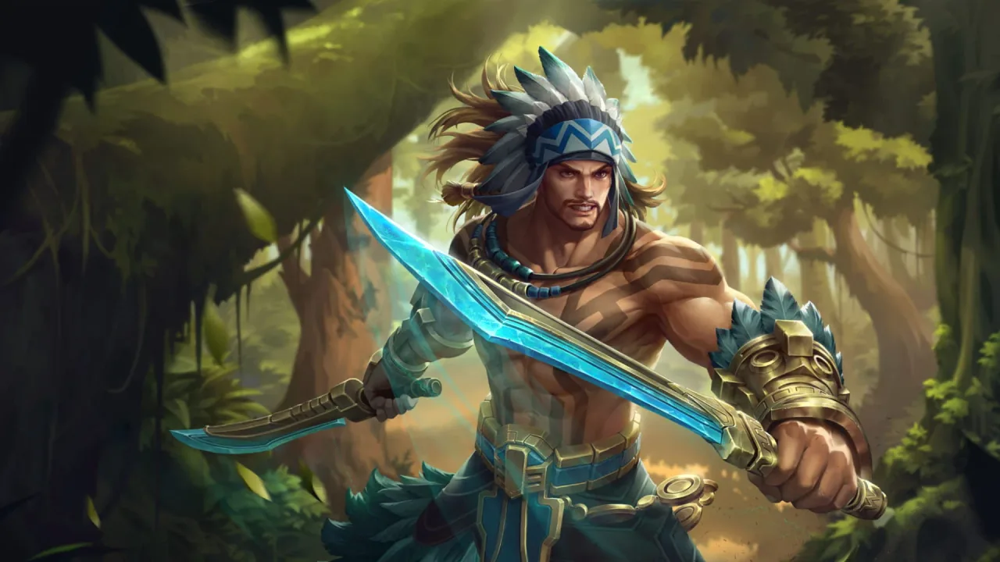

[Тир-лист](https://boostmlbb.ru/heroes/)[Предметы](https://boostmlbb.ru/items/)[Скины](https://boostmlbb.ru/skins/)[Новости и гайды](https://boostmlbb.ru/news/)

[Скины](https://boostmlbb.ru/skins/)/[Лапу-Лапу](https://boostmlbb.ru/skins/lapu-lapu.html)/Клинок предков

[Скин Лапу-Лапу](https://boostmlbb.ru/skins/lapu-lapu.html)

# Клинок предков

Ancestral Blade

Обычный CommonВ продаже

Как получить

Продаётся в магазине обликов за 269 алмазов.

Цена

269 алмазов

Вышел

11 августа 2017

## Что меняет облик

-   Бонус к характеристикам

## Все скины Лапу-Лапу [6](https://boostmlbb.ru/skins/lapu-lapu.html)

[Избранник АдлауИзысканный · 2024](https://boostmlbb.ru/skins/lapu-lapu/adlaw-s-chosen.html)[Сын дикой природыОбычный · 2022](https://boostmlbb.ru/skins/lapu-lapu/son-of-the-wild.html)[СпецназИсключительный · 2021](https://boostmlbb.ru/skins/lapu-lapu/special-force.html)[ВулканИсключительный · 2019](https://boostmlbb.ru/skins/lapu-lapu/vulcan.html)[Клинок предковОбычный · 2017](https://boostmlbb.ru/skins/lapu-lapu/ancestral-blade.html)[Имперский чемпионОбычный · 2017](https://boostmlbb.ru/skins/lapu-lapu/imperial-champion.html)

**Поднимем ранг на герое Лапу-Лапу**Цена считается в калькуляторе

[Рассчитать цену](https://boostmlbb.ru/order.html?type=hero)

## Частые вопросы

Как получить скин «Клинок предков» на Лапу-Лапу?

Продаётся в магазине обликов за 269 алмазов.

Когда вышел скин «Клинок предков»?

11 августа 2017.

Какой класс у скина «Клинок предков»?

Обычный (Common).
