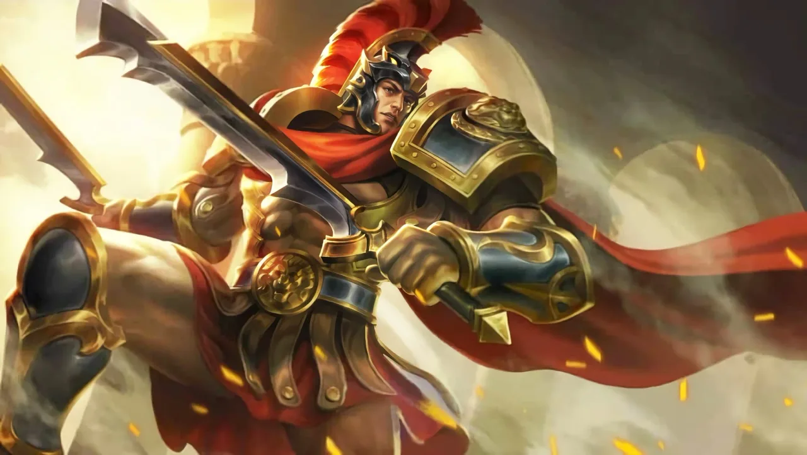

[Скины Лапу-Лапу](https://boostmlbb.ru/skins/lapu-lapu.html)

[Скины](https://boostmlbb.ru/skins/)/[Лапу-Лапу](https://boostmlbb.ru/skins/lapu-lapu.html)/Имперский чемпион

[Скин Лапу-Лапу](https://boostmlbb.ru/skins/lapu-lapu.html)

# Имперский чемпион

Imperial Champion

Обычный CommonЭлитныйВ продаже

Как получить

Продаётся в магазине обликов за 599 алмазов.

Цена

599 алмазов

Вышел

2017 год

## Что меняет облик

-   Новая внешность
-   Другой цвет эффектов
-   Анимация показа
-   Бонус к характеристикам

## Перекраски

Тот же облик в других цветах. Перекраска открывается, только если у вас уже есть сам облик.

-   **Имперский солдат** Imperial SoldierНаграда «Звёздного участника» в ноябре 2021.

## Все скины Лапу-Лапу [6](https://boostmlbb.ru/skins/lapu-lapu.html)

[Избранник АдлауИзысканный · 2024](https://boostmlbb.ru/skins/lapu-lapu/adlaw-s-chosen.html)[Сын дикой природыОбычный · 2022](https://boostmlbb.ru/skins/lapu-lapu/son-of-the-wild.html)[СпецназИсключительный · 2021](https://boostmlbb.ru/skins/lapu-lapu/special-force.html)[ВулканИсключительный · 2019](https://boostmlbb.ru/skins/lapu-lapu/vulcan.html)[Клинок предковОбычный · 2017](https://boostmlbb.ru/skins/lapu-lapu/ancestral-blade.html)[Имперский чемпионОбычный · 2017](https://boostmlbb.ru/skins/lapu-lapu/imperial-champion.html)

## Серия «Элитный»

[Золотой османтусЧан'Э · 2026](https://boostmlbb.ru/skins/change/golden-osmanthus.html)[Король-воена­чальникМартис · 2025](https://boostmlbb.ru/skins/martis/warlord-king.html)[Кадет открытого моряКимми · 2024](https://boostmlbb.ru/skins/kimmy/high-seas-cadet.html)[Зелёная копейщицаСильвана · 2024](https://boostmlbb.ru/skins/silvanna/verdant-lancer.html)[Мародёр Кровавое КопытоХилос · 2024](https://boostmlbb.ru/skins/hylos/bloodhoof-marauder.html)[Изящная бабочкаГвиневра · 2024](https://boostmlbb.ru/skins/guinevere/elegant-butterfly.html)[Маркиз клинковЛанселот · 2024](https://boostmlbb.ru/skins/lancelot/marques-of-blades.html)[Привал в пустошахЧип · 2024](https://boostmlbb.ru/skins/chip/badlands-hiatus.html)

**Сколько стоит буст на герое Лапу-Лапу?**Выберите текущий и желаемый ранг. Стоимость появится на сайте.

[Рассчитать цену](https://boostmlbb.ru/order.html?type=hero)

## Частые вопросы

Как получить скин «Имперский чемпион» на Лапу-Лапу?

Продаётся в магазине обликов за 599 алмазов.

Когда вышел скин «Имперский чемпион»?

2017 год.

Какой класс у скина «Имперский чемпион»?

Обычный (Common), серия «Элитный».
