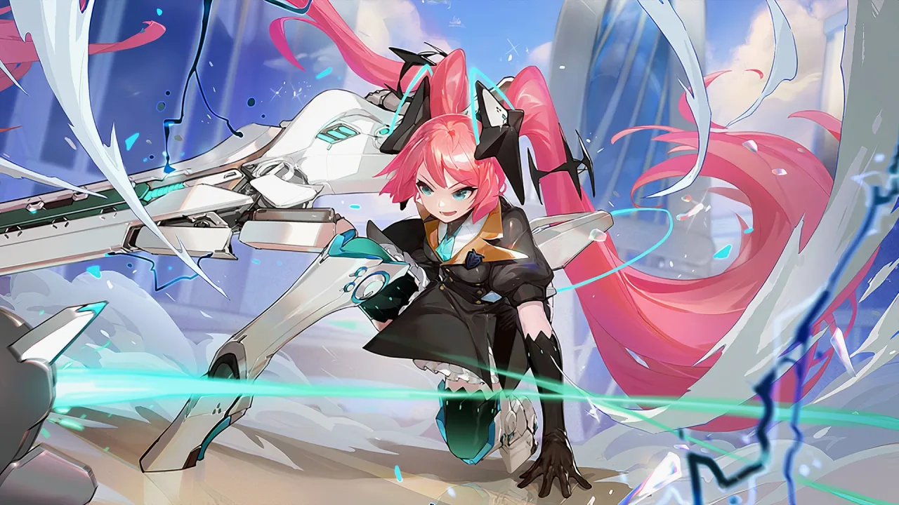

[Тир-лист](https://boostmlbb.ru/heroes/)[Предметы](https://boostmlbb.ru/items/)[Скины](https://boostmlbb.ru/skins/)[Новости и гайды](https://boostmlbb.ru/news/)

[Скины](https://boostmlbb.ru/skins/)/[Лейла](https://boostmlbb.ru/skins/layla.html)/Мисс Хикари

[Скин Лейлы](https://boostmlbb.ru/skins/layla.html)

# Мисс Хикари

Miss Hikari

Грандиозный GrandПретендентыОграниченный

Как получить

Выходил в событии «Претенденты». Ограниченные облики иногда возвращаются в розыгрышах событий.

Вышел

22 января 2022

## Что меняет облик

-   Новая внешность
-   Новые эффекты навыков
-   Звуки навыков
-   Своя озвучка
-   Иконки навыков
-   Анимация показа
-   Сцена показа
-   Музыка показа
-   Анимация появления
-   Особые действия
-   Бонус к характеристикам

## Все скины Лейлы [12](https://boostmlbb.ru/skins/layla.html)

[Призмати­ческий ритмИзысканный · 2026](https://boostmlbb.ru/skins/layla/prismatic-rhythm.html)[МаякВысший · 2025](https://boostmlbb.ru/skins/layla/the-beacon.html)[Агент паранор­мальногоИзысканный · 2024](https://boostmlbb.ru/skins/layla/paranormal-operative.html)[Сумеречный вальсИсключительный · 2023](https://boostmlbb.ru/skins/layla/twilight-waltz.html)[Мисс ХикариГрандиозный · 2022](https://boostmlbb.ru/skins/layla/miss-hikari.html)[Пылающее орудиеДелюкс · 2020](https://boostmlbb.ru/skins/layla/blazing-gun.html)[Штурмовик S.A.B.E.R.Делюкс · 2018](https://boostmlbb.ru/skins/layla/s-a-b-e-r-breacher.html)[ЗайкаИсключительный · 2017](https://boostmlbb.ru/skins/layla/bunny-babe.html)[Класси­ческая стрелок МалефикОбычный · 2017](https://boostmlbb.ru/skins/layla/classic-malefic-gunner.html)[Синий призракОбычный · 2017](https://boostmlbb.ru/skins/layla/blue-spectre.html)[Пушка и розыИсключительный · 2017](https://boostmlbb.ru/skins/layla/cannon-and-roses.html)[Зелёная вспышкаОбычный · 2016](https://boostmlbb.ru/skins/layla/green-flash.html)

## Серия «Претенденты»

[Райко Серебряная МолнияСелена · 2026](https://boostmlbb.ru/skins/selena/silverbolt-raiko.html)[Импе­ратрица АрасиОбсидия · 2026](https://boostmlbb.ru/skins/obsidia/imperatrix-arashi.html)[Сияние рассветаГвиневра · 2025](https://boostmlbb.ru/skins/guinevere/daybreak-halo.html)[Сумеречная звездаВексана · 2025](https://boostmlbb.ru/skins/vexana/twilight-star.html)[Техни­ческий генийЧан'Э · 2024](https://boostmlbb.ru/skins/change/tech-tensai.html)[Меткий призракЛесли · 2024](https://boostmlbb.ru/skins/lesley/deadeye-spectre.html)[Меха-деваРуби · 2023](https://boostmlbb.ru/skins/ruby/mecha-maiden.html)[Клинок надеждыФанни · 2022](https://boostmlbb.ru/skins/fanny/blade-of-kibou.html)

**Поднимем ранг на герое Лейла**Цена считается в калькуляторе

[Рассчитать цену](https://boostmlbb.ru/order.html?type=hero)

## Частые вопросы

Как получить скин «Мисс Хикари» на Лейлу?

Выходил в событии «Претенденты». Ограниченные облики иногда возвращаются в розыгрышах событий.

Когда вышел скин «Мисс Хикари»?

22 января 2022.

Какой класс у скина «Мисс Хикари»?

Грандиозный (Grand), серия «Претенденты».
