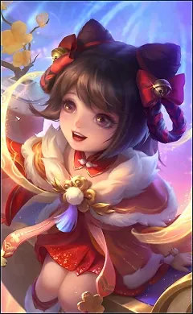

[Тир-лист](https://boostmlbb.ru/heroes/)[Предметы](https://boostmlbb.ru/items/)[Скины](https://boostmlbb.ru/skins/)[Новости и гайды](https://boostmlbb.ru/news/)

[Скины](https://boostmlbb.ru/skins/)/[Леоморд](https://boostmlbb.ru/skins/leomord.html)/Благое пламя

[Скин Леоморда](https://boostmlbb.ru/skins/leomord.html)

# Благое пламя

Auspicious Blaze

Делюкс DeluxeЛунный фестивальОграниченный

Как получить

Выходил в магазине обликов во время события. Ограниченные облики иногда возвращаются в розыгрышах событий.

Вышел

13 февраля 2026

## Что меняет облик

-   Новая внешность
-   Новые эффекты навыков
-   Звуки навыков
-   Анимация показа
-   Сцена показа
-   Бонус к характеристикам

## Все скины Леоморда [9](https://boostmlbb.ru/skins/leomord.html)

[Благое пламяДелюкс · 2026](https://boostmlbb.ru/skins/leomord/auspicious-blaze.html)[Граф кошмаровДелюкс · 2025](https://boostmlbb.ru/skins/leomord/nightmare-count.html)[Триумф: ОрёлИсключительный · 2024](https://boostmlbb.ru/skins/leomord/triumph-eagle.html)[Гонщик на Diavel V4Грандиозный · 2023](https://boostmlbb.ru/skins/leomord/diavel-v4-rider.html)[Рыцарь тениГрандиозный · 2023](https://boostmlbb.ru/skins/leomord/shadow-knight.html)[Адский рыцарьОбычный · 2022](https://boostmlbb.ru/skins/leomord/hell-knight.html)[Светильник ДжекаИсключительный · 2020](https://boostmlbb.ru/skins/leomord/jack-o-lantern.html)[Душа преис­поднейИзысканный · 2019](https://boostmlbb.ru/skins/leomord/inferno-soul.html)[Паладин, рождённый во льдахИсключительный · 2019](https://boostmlbb.ru/skins/leomord/frostborn-paladin.html)

## Серия «Лунный фестиваль»

[Цветение изобилияРафаэль · 2025](https://boostmlbb.ru/skins/rafaela/bloom-of-abundance.html)[Дракон процве­танияЗилонг · 2024](https://boostmlbb.ru/skins/zilong/dragon-of-prosperity.html)[НоволуниеЧан'Э · 2023](https://boostmlbb.ru/skins/change/new-moon.html)[Весенние благос­ловенияСан · 2022](https://boostmlbb.ru/skins/sun/spring-blessings.html)[Рассветная удачаЛо Йи · 2021](https://boostmlbb.ru/skins/luo-yi/dawning-fortune.html)[Благая удачаОдетта · 2019](https://boostmlbb.ru/skins/odette/auspicious-charm.html)[Танец льваЛолита · 2019](https://boostmlbb.ru/skins/lolita/lion-dance.html)[Лисья ледиАврора · 2018](https://boostmlbb.ru/skins/aurora/foxy-lady.html)

**Поднимем ранг на герое Леоморд**Цена считается в калькуляторе

[Рассчитать цену](https://boostmlbb.ru/order.html?type=hero)

## Частые вопросы

Как получить скин «Благое пламя» на Леоморда?

Выходил в магазине обликов во время события. Ограниченные облики иногда возвращаются в розыгрышах событий.

Когда вышел скин «Благое пламя»?

13 февраля 2026.

Какой класс у скина «Благое пламя»?

Делюкс (Deluxe), серия «Лунный фестиваль».
