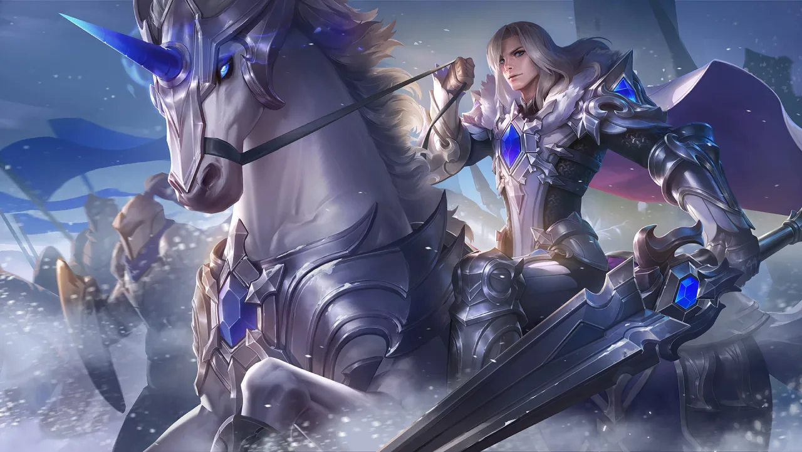

[Тир-лист](https://boostmlbb.ru/heroes/)[Предметы](https://boostmlbb.ru/items/)[Скины](https://boostmlbb.ru/skins/)[Новости и гайды](https://boostmlbb.ru/news/)

[Скины](https://boostmlbb.ru/skins/)/[Леоморд](https://boostmlbb.ru/skins/leomord.html)/Паладин, рождённый во льдах

[Скин Леоморда](https://boostmlbb.ru/skins/leomord.html)

# Паладин, рождённый во льдах

Frostborn Paladin

Исключительный ExceptionalЗвёздный участникОграниченный

Как получить

Награда «Звёздного участника» в январе 2019.

Вышел

1 января 2019

## Что меняет облик

-   Новая внешность
-   Новые эффекты навыков
-   Анимация показа
-   Бонус к характеристикам

## Все скины Леоморда [9](https://boostmlbb.ru/skins/leomord.html)

[Благое пламяДелюкс · 2026](https://boostmlbb.ru/skins/leomord/auspicious-blaze.html)[Граф кошмаровДелюкс · 2025](https://boostmlbb.ru/skins/leomord/nightmare-count.html)[Триумф: ОрёлИсключительный · 2024](https://boostmlbb.ru/skins/leomord/triumph-eagle.html)[Гонщик на Diavel V4Грандиозный · 2023](https://boostmlbb.ru/skins/leomord/diavel-v4-rider.html)[Рыцарь тениГрандиозный · 2023](https://boostmlbb.ru/skins/leomord/shadow-knight.html)[Адский рыцарьОбычный · 2022](https://boostmlbb.ru/skins/leomord/hell-knight.html)[Светильник ДжекаИсключительный · 2020](https://boostmlbb.ru/skins/leomord/jack-o-lantern.html)[Душа преис­поднейИзысканный · 2019](https://boostmlbb.ru/skins/leomord/inferno-soul.html)[Паладин, рождённый во льдахИсключительный · 2019](https://boostmlbb.ru/skins/leomord/frostborn-paladin.html)

## Серия «Звёздный участник»

[Морячка, рождённая приливомКалеа · 2026](https://boostmlbb.ru/skins/kalea/tideborn-sailor.html)[Тень кицунэХаябуса · 2026](https://boostmlbb.ru/skins/hayabusa/kitsune-s-shadow.html)[Клыки резниХанзо · 2026](https://boostmlbb.ru/skins/hanzo/fangs-of-slaughter.html)[Тлеющая крепостьБелерик · 2026](https://boostmlbb.ru/skins/belerick/smouldering-fortress.html)[Магитех­нический призракОбсидия · 2026](https://boostmlbb.ru/skins/obsidia/magitech-wraith.html)[Элизийское сияниеЦзэтянь · 2026](https://boostmlbb.ru/skins/zetian/elysian-luminance.html)[Батальон стражейХильда · 2026](https://boostmlbb.ru/skins/hilda/guardian-battalion.html)[Мечта­тельный коиХарли · 2026](https://boostmlbb.ru/skins/harley/dreaming-koi.html)

**Поднимем ранг на герое Леоморд**Цена считается в калькуляторе

[Рассчитать цену](https://boostmlbb.ru/order.html?type=hero)

## Частые вопросы

Как получить скин «Паладин, рождённый во льдах» на Леоморда?

Награда «Звёздного участника» в январе 2019.

Когда вышел скин «Паладин, рождённый во льдах»?

1 января 2019.

Какой класс у скина «Паладин, рождённый во льдах»?

Исключительный (Exceptional), серия «Звёздный участник».
