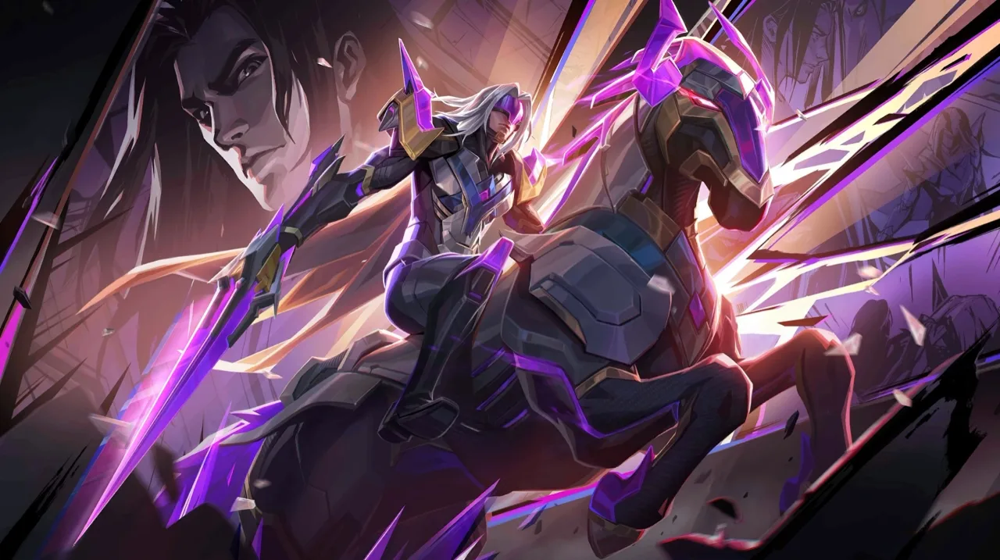
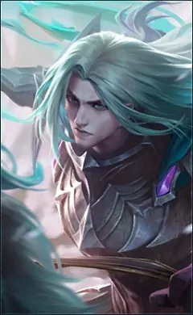

[Тир-лист](https://boostmlbb.ru/heroes/)[Предметы](https://boostmlbb.ru/items/)[Скины](https://boostmlbb.ru/skins/)[Новости и гайды](https://boostmlbb.ru/news/)

[Скины](https://boostmlbb.ru/skins/)/[Леоморд](https://boostmlbb.ru/skins/leomord.html)/Рыцарь тени

[Скин Леоморда](https://boostmlbb.ru/skins/leomord.html)

# Рыцарь тени

Shadow Knight

Грандиозный GrandABYSSОграниченный

Как получить

Выходил в событии «ABYSS». Ограниченные облики иногда возвращаются в розыгрышах событий.

Вышел

18 февраля 2023

## Что меняет облик

-   Новая внешность
-   Новые эффекты навыков
-   Звуки навыков
-   Своя озвучка
-   Иконки навыков
-   Анимация показа
-   Сцена показа
-   Музыка показа
-   Анимация появления
-   Особые действия
-   Бонус к характеристикам

## Все скины Леоморда [9](https://boostmlbb.ru/skins/leomord.html)

[Благое пламяДелюкс · 2026](https://boostmlbb.ru/skins/leomord/auspicious-blaze.html)[Граф кошмаровДелюкс · 2025](https://boostmlbb.ru/skins/leomord/nightmare-count.html)[Триумф: ОрёлИсключительный · 2024](https://boostmlbb.ru/skins/leomord/triumph-eagle.html)[Гонщик на Diavel V4Грандиозный · 2023](https://boostmlbb.ru/skins/leomord/diavel-v4-rider.html)[Рыцарь тениГрандиозный · 2023](https://boostmlbb.ru/skins/leomord/shadow-knight.html)[Адский рыцарьОбычный · 2022](https://boostmlbb.ru/skins/leomord/hell-knight.html)[Светильник ДжекаИсключительный · 2020](https://boostmlbb.ru/skins/leomord/jack-o-lantern.html)[Душа преис­поднейИзысканный · 2019](https://boostmlbb.ru/skins/leomord/inferno-soul.html)[Паладин, рождённый во льдахИсключительный · 2019](https://boostmlbb.ru/skins/leomord/frostborn-paladin.html)

## Серия «ABYSS»

[Воплощение рокаМосков · 2023](https://boostmlbb.ru/skins/moskov/doom-incarnate.html)[Генерал ПустотаАльфа · 2023](https://boostmlbb.ru/skins/alpha/general-void.html)[Леди МестьСелена · 2021](https://boostmlbb.ru/skins/selena/lady-vengeance.html)

**Поднимем ранг на герое Леоморд**Цена считается в калькуляторе

[Рассчитать цену](https://boostmlbb.ru/order.html?type=hero)

## Частые вопросы

Как получить скин «Рыцарь тени» на Леоморда?

Выходил в событии «ABYSS». Ограниченные облики иногда возвращаются в розыгрышах событий.

Когда вышел скин «Рыцарь тени»?

18 февраля 2023.

Какой класс у скина «Рыцарь тени»?

Грандиозный (Grand), серия «ABYSS».
