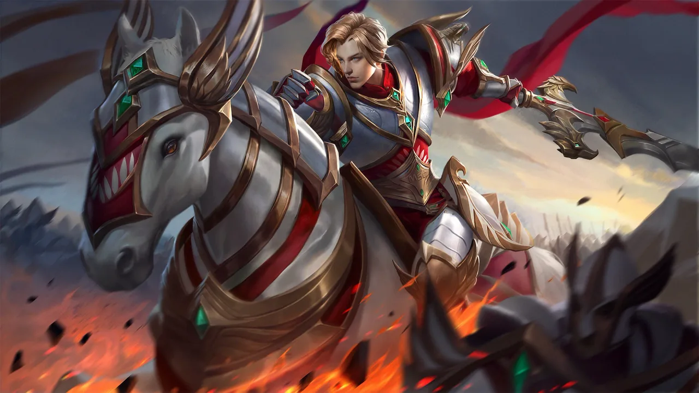

[Скины Леоморда](https://boostmlbb.ru/skins/leomord.html)

[Скины](https://boostmlbb.ru/skins/)/[Леоморд](https://boostmlbb.ru/skins/leomord.html)/Триумф: Орёл

[Скин Леоморда](https://boostmlbb.ru/skins/leomord.html)

# Триумф: Орёл

Triumph - Eagle

Исключительный ExceptionalMSC 2019Ограниченный

Как получить

Киберспортивный облик (MSC 2019): выходил в событии турнира. Ограниченные облики иногда возвращаются в розыгрышах событий.

Вышел

16 марта 2024

## Что меняет облик

-   Новая внешность
-   Новые эффекты навыков
-   Анимация показа
-   Бонус к характеристикам

## Все скины Леоморда [9](https://boostmlbb.ru/skins/leomord.html)

[Благое пламяДелюкс · 2026](https://boostmlbb.ru/skins/leomord/auspicious-blaze.html)[Граф кошмаровДелюкс · 2025](https://boostmlbb.ru/skins/leomord/nightmare-count.html)[Триумф: ОрёлИсключительный · 2024](https://boostmlbb.ru/skins/leomord/triumph-eagle.html)[Гонщик на Diavel V4Грандиозный · 2023](https://boostmlbb.ru/skins/leomord/diavel-v4-rider.html)[Рыцарь тениГрандиозный · 2023](https://boostmlbb.ru/skins/leomord/shadow-knight.html)[Адский рыцарьОбычный · 2022](https://boostmlbb.ru/skins/leomord/hell-knight.html)[Светильник ДжекаИсключительный · 2020](https://boostmlbb.ru/skins/leomord/jack-o-lantern.html)[Душа преис­поднейИзысканный · 2019](https://boostmlbb.ru/skins/leomord/inferno-soul.html)[Паладин, рождённый во льдахИсключительный · 2019](https://boostmlbb.ru/skins/leomord/frostborn-paladin.html)

**Сколько стоит буст на герое Леоморд?**Выберите текущий и желаемый ранг. Стоимость появится на сайте.

[Рассчитать цену](https://boostmlbb.ru/order.html?type=hero)

## Частые вопросы

Как получить скин «Триумф: Орёл» на Леоморда?

Киберспортивный облик (MSC 2019): выходил в событии турнира. Ограниченные облики иногда возвращаются в розыгрышах событий.

Когда вышел скин «Триумф: Орёл»?

16 марта 2024.

Какой класс у скина «Триумф: Орёл»?

Исключительный (Exceptional), серия «MSC 2019».
