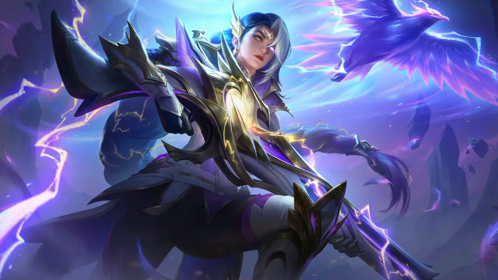

[Тир-лист](https://boostmlbb.ru/heroes/)[Предметы](https://boostmlbb.ru/items/)[Скины](https://boostmlbb.ru/skins/)[Новости и гайды](https://boostmlbb.ru/news/)

[Скины](https://boostmlbb.ru/skins/)/[Лесли](https://boostmlbb.ru/skins/lesley.html)/Зоркий снайпер

[Скин Лесли](https://boostmlbb.ru/skins/lesley.html)

# Зоркий снайпер

Hawk-eyed Sniper

Изысканный ExquisiteЕжегодный звёздный участникОграниченный

Как получить

Событие StarLight Fest 2021.

Вышел

21 ноября 2021

## Что меняет облик

-   Новая внешность
-   Новые эффекты навыков
-   Звуки навыков
-   Своя озвучка
-   Анимация показа
-   Сцена показа
-   Музыка показа
-   Особые действия
-   Бонус к характеристикам

## Все скины Лесли [12](https://boostmlbb.ru/skins/lesley.html)

[Охотница из МяукиновДелюкс · 2025](https://boostmlbb.ru/skins/lesley/meowkin-hunter.html)[Герцогиня приливовДелюкс · 2025](https://boostmlbb.ru/skins/lesley/duchess-of-tides.html)[Меткий призракГрандиозный · 2024](https://boostmlbb.ru/skins/lesley/deadeye-spectre.html)[Зоркий снайперИзысканный · 2021](https://boostmlbb.ru/skins/lesley/hawk-eyed-sniper.html)[Повели­тельница соколовИзысканный · 2021](https://boostmlbb.ru/skins/lesley/falcon-mistress.html)[Смерто­носная ледиИсключительный · 2020](https://boostmlbb.ru/skins/lesley/lethal-lady.html)[Ангельский агентВысший · 2019](https://boostmlbb.ru/skins/lesley/angelic-agent.html)[Опасная любовьИсключительный · 2019](https://boostmlbb.ru/skins/lesley/dangerous-love.html)[Призрак СтелларисИзысканный · 2018](https://boostmlbb.ru/skins/lesley/stellaris-ghost.html)[Стрелок-чирлидерИсключительный · 2018](https://boostmlbb.ru/skins/lesley/cheergunner.html)[Коро­левский мушкетёрОбычный · 2018](https://boostmlbb.ru/skins/lesley/royal-musketeer.html)[Генерал РозаОбычный · 2018](https://boostmlbb.ru/skins/lesley/general-rosa.html)

## Серия «Ежегодный звёздный участник»

[Концерт светаВэйл · 2024](https://boostmlbb.ru/skins/vale/concerto-of-light.html)[Аватар времениАнгела · 2023](https://boostmlbb.ru/skins/angela/avatar-of-time.html)[КувшинкаКагура · 2021](https://boostmlbb.ru/skins/kagura/water-lily.html)[Неоновое колесоКэрри · 2020](https://boostmlbb.ru/skins/karrie/neon-lightwheel.html)[Контролёр №1Горд · 2019](https://boostmlbb.ru/skins/gord/no-1-controller.html)[Экспе­римент 21Хаябуса · 2018](https://boostmlbb.ru/skins/hayabusa/experiment-21.html)

**Поднимем ранг на герое Лесли**Цена считается в калькуляторе

[Рассчитать цену](https://boostmlbb.ru/order.html?type=hero)

## Частые вопросы

Как получить скин «Зоркий снайпер» на Лесли?

Событие StarLight Fest 2021.

Когда вышел скин «Зоркий снайпер»?

21 ноября 2021.

Какой класс у скина «Зоркий снайпер»?

Изысканный (Exquisite), серия «Ежегодный звёздный участник».
