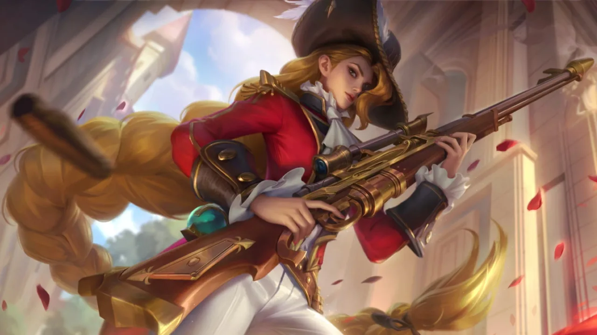

[Тир-лист](https://boostmlbb.ru/heroes/)[Предметы](https://boostmlbb.ru/items/)[Скины](https://boostmlbb.ru/skins/)[Новости и гайды](https://boostmlbb.ru/news/)

[Скины](https://boostmlbb.ru/skins/)/[Лесли](https://boostmlbb.ru/skins/lesley.html)/Королевский мушкетёр

[Скин Лесли](https://boostmlbb.ru/skins/lesley.html)

# Королевский мушкетёр

Royal Musketeer

Обычный CommonВ продаже

Как получить

Продаётся в магазине обликов за 269 алмазов.

Цена

269 алмазов

Вышел

6 февраля 2018

## Что меняет облик

-   Бонус к характеристикам

## Все скины Лесли [12](https://boostmlbb.ru/skins/lesley.html)

[Охотница из МяукиновДелюкс · 2025](https://boostmlbb.ru/skins/lesley/meowkin-hunter.html)[Герцогиня приливовДелюкс · 2025](https://boostmlbb.ru/skins/lesley/duchess-of-tides.html)[Меткий призракГрандиозный · 2024](https://boostmlbb.ru/skins/lesley/deadeye-spectre.html)[Зоркий снайперИзысканный · 2021](https://boostmlbb.ru/skins/lesley/hawk-eyed-sniper.html)[Повели­тельница соколовИзысканный · 2021](https://boostmlbb.ru/skins/lesley/falcon-mistress.html)[Смерто­носная ледиИсключительный · 2020](https://boostmlbb.ru/skins/lesley/lethal-lady.html)[Ангельский агентВысший · 2019](https://boostmlbb.ru/skins/lesley/angelic-agent.html)[Опасная любовьИсключительный · 2019](https://boostmlbb.ru/skins/lesley/dangerous-love.html)[Призрак СтелларисИзысканный · 2018](https://boostmlbb.ru/skins/lesley/stellaris-ghost.html)[Стрелок-чирлидерИсключительный · 2018](https://boostmlbb.ru/skins/lesley/cheergunner.html)[Коро­левский мушкетёрОбычный · 2018](https://boostmlbb.ru/skins/lesley/royal-musketeer.html)[Генерал РозаОбычный · 2018](https://boostmlbb.ru/skins/lesley/general-rosa.html)

**Поднимем ранг на герое Лесли**Цена считается в калькуляторе

[Рассчитать цену](https://boostmlbb.ru/order.html?type=hero)

## Частые вопросы

Как получить скин «Королевский мушкетёр» на Лесли?

Продаётся в магазине обликов за 269 алмазов.

Когда вышел скин «Королевский мушкетёр»?

6 февраля 2018.

Какой класс у скина «Королевский мушкетёр»?

Обычный (Common).
