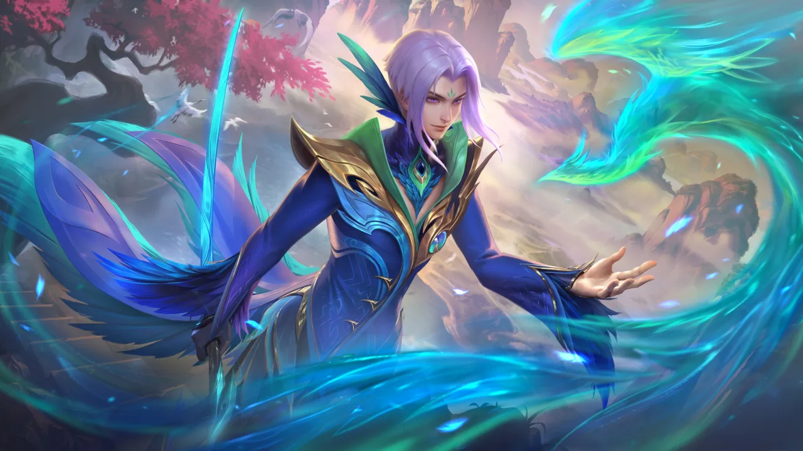
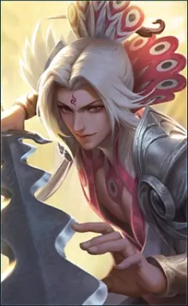

[Тир-лист](https://boostmlbb.ru/heroes/)[Предметы](https://boostmlbb.ru/items/)[Скины](https://boostmlbb.ru/skins/)[Новости и гайды](https://boostmlbb.ru/news/)

[Скины](https://boostmlbb.ru/skins/)/Линг

# Скины Линга

Скинов

8

Можно купить

2

Последний

[Линг Neobeast](https://boostmlbb.ru/skins/ling/neobeast-ling.html)2025

[Профиль героя→](https://boostmlbb.ru/heroes/ling.html)

## Все скины

ВсеГрандиозныйИзысканныйДелюксИсключительныйОбычный

[Линг NeobeastГрандиозный · 2025](https://boostmlbb.ru/skins/ling/neobeast-ling.html)[Косми­ческий стражИсключительный · 2024](https://boostmlbb.ru/skins/ling/cosmo-guard.html)[Ночная теньДелюкс · 2024](https://boostmlbb.ru/skins/ling/night-shade.html)[Лорд ШэньГрандиозный · 2022](https://boostmlbb.ru/skins/ling/lord-shen.html)[Линг M-WorldДелюкс · 2022](https://boostmlbb.ru/skins/ling/m-world-ling.html)[Безмя­тежное пероИзысканный · 2021](https://boostmlbb.ru/skins/ling/serene-plume.html)[Уличный панкИсключительный · 2020](https://boostmlbb.ru/skins/ling/street-punk.html)[Огненный танецОбычный · 2019](https://boostmlbb.ru/skins/ling/fiery-dance.html)

**Поднимем ранг на герое Линг**Цена считается в калькуляторе

[Рассчитать цену](https://boostmlbb.ru/order.html?type=hero)

## Частые вопросы

Сколько скинов у Линга?

8 скинов без стандартного облика. Последний — «Линг Neobeast» (Neobeast Ling), 12 апреля 2025.

Какие скины Линга можно купить сейчас?

«Ночная тень» (899 алмазов), «Огненный танец» (269 алмазов). Остальные облики ограниченные и возвращаются только в событиях.

Какой самый редкий скин Линга?

«Линг Neobeast» (Neobeast Ling), класс грандиозный, серия «Neobeast». Выходил в событии «Neobeast». Ограниченные облики иногда возвращаются в розыгрышах событий.
