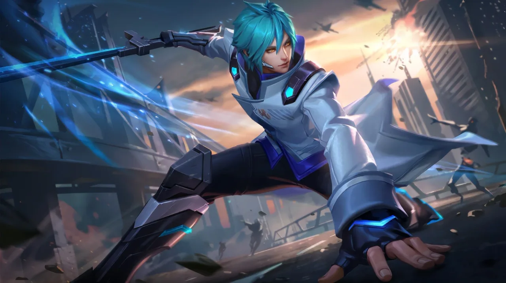

[Скины Линга](https://boostmlbb.ru/skins/ling.html)

[Скины](https://boostmlbb.ru/skins/)/[Линг](https://boostmlbb.ru/skins/ling.html)/Космический страж

[Скин Линга](https://boostmlbb.ru/skins/ling.html)

# Космический страж

Cosmo Guard

Исключительный ExceptionalОсобыйОграниченный

Как получить

Выходил в магазине обликов во время события. Ограниченные облики иногда возвращаются в розыгрышах событий.

Вышел

17 июля 2024

## Что меняет облик

-   Новая внешность
-   Новые эффекты навыков
-   Анимация показа
-   Бонус к характеристикам

## Все скины Линга [8](https://boostmlbb.ru/skins/ling.html)

[Линг NeobeastГрандиозный · 2025](https://boostmlbb.ru/skins/ling/neobeast-ling.html)[Косми­ческий стражИсключительный · 2024](https://boostmlbb.ru/skins/ling/cosmo-guard.html)[Ночная теньДелюкс · 2024](https://boostmlbb.ru/skins/ling/night-shade.html)[Лорд ШэньГрандиозный · 2022](https://boostmlbb.ru/skins/ling/lord-shen.html)[Линг M-WorldДелюкс · 2022](https://boostmlbb.ru/skins/ling/m-world-ling.html)[Безмя­тежное пероИзысканный · 2021](https://boostmlbb.ru/skins/ling/serene-plume.html)[Уличный панкИсключительный · 2020](https://boostmlbb.ru/skins/ling/street-punk.html)[Огненный танецОбычный · 2019](https://boostmlbb.ru/skins/ling/fiery-dance.html)

## Серия «Особый»

[Тайный вердиктМатильда · 2026](https://boostmlbb.ru/skins/mathilda/arcane-verdict.html)[Вальс на ветруВэйл · 2026](https://boostmlbb.ru/skins/vale/windborne-waltz.html)[Капитан потерянныхФранко · 2026](https://boostmlbb.ru/skins/franco/captain-of-the-lost.html)[ВолнорезЛи Сун-Син · 2025](https://boostmlbb.ru/skins/yi-sun-shin/wavebreaker.html)[Стальные рукиБаданг · 2025](https://boostmlbb.ru/skins/badang/steel-arms.html)[Леди с зонтикомКагура · 2025](https://boostmlbb.ru/skins/kagura/lady-parasol.html)[Ужас пучиныАлдос · 2025](https://boostmlbb.ru/skins/aldous/fathom-terror.html)[Труппа лунного светаЧан'Э · 2025](https://boostmlbb.ru/skins/change/moonglow-troupe.html)

**Сколько стоит буст на герое Линг?**Выберите текущий и желаемый ранг. Стоимость появится на сайте.

[Рассчитать цену](https://boostmlbb.ru/order.html?type=hero)

## Частые вопросы

Как получить скин «Космический страж» на Линга?

Выходил в магазине обликов во время события. Ограниченные облики иногда возвращаются в розыгрышах событий.

Когда вышел скин «Космический страж»?

17 июля 2024.

Какой класс у скина «Космический страж»?

Исключительный (Exceptional), серия «Особый».
