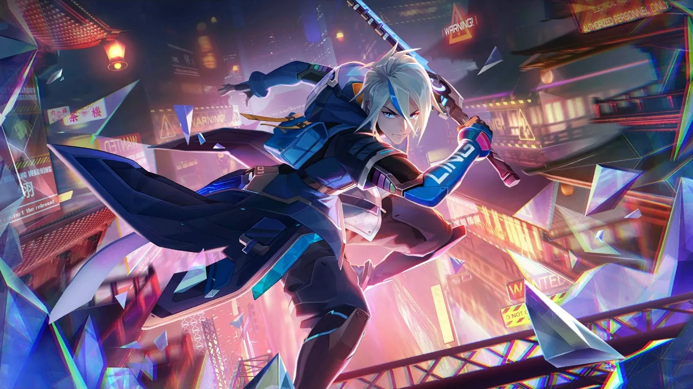
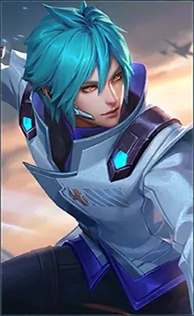

[Скины Линга](https://boostmlbb.ru/skins/ling.html)

[Скины](https://boostmlbb.ru/skins/)/[Линг](https://boostmlbb.ru/skins/ling.html)/Линг M-World

[Скин Линга](https://boostmlbb.ru/skins/ling.html)

# Линг M-World

M-World Ling

Делюкс DeluxeM-WorldОграниченный

Как получить

Выходил в событии «M-World». Ограниченные облики иногда возвращаются в розыгрышах событий.

Вышел

23 апреля 2022

## Что меняет облик

-   Новая внешность
-   Новые эффекты навыков
-   Звуки навыков
-   Своя озвучка
-   Анимация показа
-   Сцена показа
-   Бонус к характеристикам

## Все скины Линга [8](https://boostmlbb.ru/skins/ling.html)

[Линг NeobeastГрандиозный · 2025](https://boostmlbb.ru/skins/ling/neobeast-ling.html)[Косми­ческий стражИсключительный · 2024](https://boostmlbb.ru/skins/ling/cosmo-guard.html)[Ночная теньДелюкс · 2024](https://boostmlbb.ru/skins/ling/night-shade.html)[Лорд ШэньГрандиозный · 2022](https://boostmlbb.ru/skins/ling/lord-shen.html)[Линг M-WorldДелюкс · 2022](https://boostmlbb.ru/skins/ling/m-world-ling.html)[Безмя­тежное пероИзысканный · 2021](https://boostmlbb.ru/skins/ling/serene-plume.html)[Уличный панкИсключительный · 2020](https://boostmlbb.ru/skins/ling/street-punk.html)[Огненный танецОбычный · 2019](https://boostmlbb.ru/skins/ling/fiery-dance.html)

## Серия «M-World»

[Инь M-WorldИнь · 2022](https://boostmlbb.ru/skins/yin/m-world-yin.html)[Ванван M-WorldВанван · 2022](https://boostmlbb.ru/skins/wanwan/m-world-wanwan.html)

**Сколько стоит буст на герое Линг?**Выберите текущий и желаемый ранг. Стоимость появится на сайте.

[Рассчитать цену](https://boostmlbb.ru/order.html?type=hero)

## Частые вопросы

Как получить скин «Линг M-World» на Линга?

Выходил в событии «M-World». Ограниченные облики иногда возвращаются в розыгрышах событий.

Когда вышел скин «Линг M-World»?

23 апреля 2022.

Какой класс у скина «Линг M-World»?

Делюкс (Deluxe), серия «M-World».
