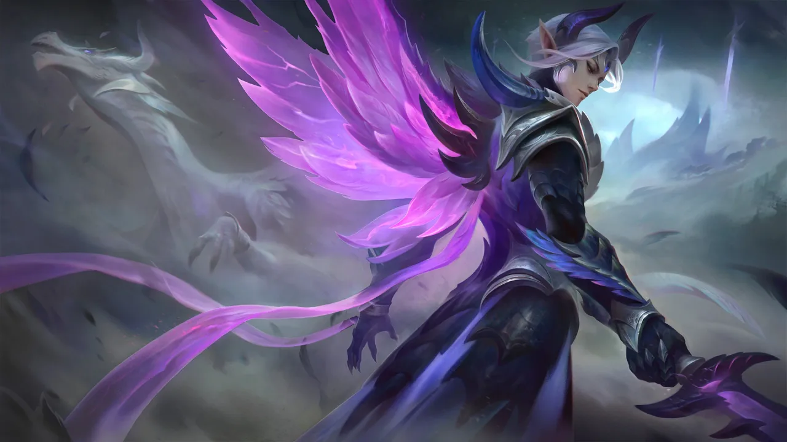

[Скины Линга](https://boostmlbb.ru/skins/ling.html)

[Скины](https://boostmlbb.ru/skins/)/[Линг](https://boostmlbb.ru/skins/ling.html)/Ночная тень

[Скин Линга](https://boostmlbb.ru/skins/ling.html)

# Ночная тень

Night Shade

Делюкс DeluxeУкротители драконовВ продаже

Как получить

Продаётся в магазине обликов за 899 алмазов.

Цена

899 алмазов

Вышел

13 февраля 2024

## Что меняет облик

-   Новая внешность
-   Новые эффекты навыков
-   Анимация показа
-   Сцена показа
-   Бонус к характеристикам

## Все скины Линга [8](https://boostmlbb.ru/skins/ling.html)

[Линг NeobeastГрандиозный · 2025](https://boostmlbb.ru/skins/ling/neobeast-ling.html)[Косми­ческий стражИсключительный · 2024](https://boostmlbb.ru/skins/ling/cosmo-guard.html)[Ночная теньДелюкс · 2024](https://boostmlbb.ru/skins/ling/night-shade.html)[Лорд ШэньГрандиозный · 2022](https://boostmlbb.ru/skins/ling/lord-shen.html)[Линг M-WorldДелюкс · 2022](https://boostmlbb.ru/skins/ling/m-world-ling.html)[Безмя­тежное пероИзысканный · 2021](https://boostmlbb.ru/skins/ling/serene-plume.html)[Уличный панкИсключительный · 2020](https://boostmlbb.ru/skins/ling/street-punk.html)[Огненный танецОбычный · 2019](https://boostmlbb.ru/skins/ling/fiery-dance.html)

## Серия «Укротители драконов»

[Морозное крылоКимми · 2025](https://boostmlbb.ru/skins/kimmy/frost-wing.html)[Небесное пламяЛанселот · 2021](https://boostmlbb.ru/skins/lancelot/empyrean-flame.html)[Драконья броняМаша · 2020](https://boostmlbb.ru/skins/masha/dragon-armor.html)[Драконье пламяВалир · 2019](https://boostmlbb.ru/skins/valir/draconic-flame.html)[Ротанговый драконЭстес · 2017](https://boostmlbb.ru/skins/estes/rattan-dragon.html)

**Сколько стоит буст на герое Линг?**Выберите текущий и желаемый ранг. Стоимость появится на сайте.

[Рассчитать цену](https://boostmlbb.ru/order.html?type=hero)

## Частые вопросы

Как получить скин «Ночная тень» на Линга?

Продаётся в магазине обликов за 899 алмазов.

Когда вышел скин «Ночная тень»?

13 февраля 2024.

Какой класс у скина «Ночная тень»?

Делюкс (Deluxe), серия «Укротители драконов».
