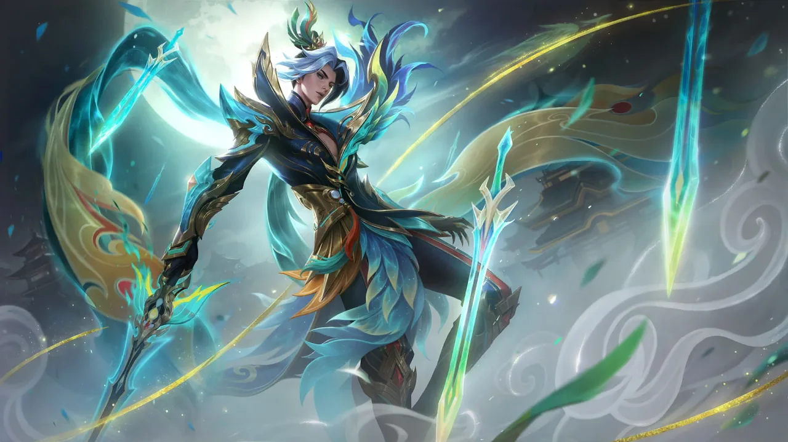
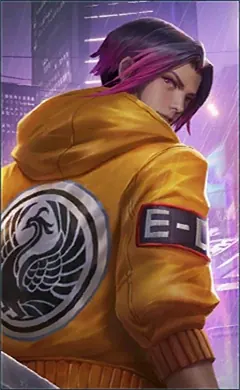

[Тир-лист](https://boostmlbb.ru/heroes/)[Предметы](https://boostmlbb.ru/items/)[Скины](https://boostmlbb.ru/skins/)[Новости и гайды](https://boostmlbb.ru/news/)

[Скины](https://boostmlbb.ru/skins/)/[Линг](https://boostmlbb.ru/skins/ling.html)/Безмятежное перо

[Скин Линга](https://boostmlbb.ru/skins/ling.html)

# Безмятежное перо

Serene Plume

Изысканный ExquisiteКоллекционныйОграниченный

Как получить

Главный приз розыгрыша в коллекционном событии, попытки покупаются за алмазы. Ограниченные облики иногда возвращаются в розыгрышах событий.

Вышел

5 июня 2021

## Что меняет облик

-   Новая внешность
-   Новые эффекты навыков
-   Звуки навыков
-   Своя озвучка
-   Анимация показа
-   Сцена показа
-   Бонус к характеристикам

## Все скины Линга [8](https://boostmlbb.ru/skins/ling.html)

[Линг NeobeastГрандиозный · 2025](https://boostmlbb.ru/skins/ling/neobeast-ling.html)[Косми­ческий стражИсключительный · 2024](https://boostmlbb.ru/skins/ling/cosmo-guard.html)[Ночная теньДелюкс · 2024](https://boostmlbb.ru/skins/ling/night-shade.html)[Лорд ШэньГрандиозный · 2022](https://boostmlbb.ru/skins/ling/lord-shen.html)[Линг M-WorldДелюкс · 2022](https://boostmlbb.ru/skins/ling/m-world-ling.html)[Безмя­тежное пероИзысканный · 2021](https://boostmlbb.ru/skins/ling/serene-plume.html)[Уличный панкИсключительный · 2020](https://boostmlbb.ru/skins/ling/street-punk.html)[Огненный танецОбычный · 2019](https://boostmlbb.ru/skins/ling/fiery-dance.html)

## Серия «Коллекционный»

[ОчистительБруно · 2026](https://boostmlbb.ru/skins/bruno/the-purifier.html)[Небесный бунтарьСан · 2026](https://boostmlbb.ru/skins/sun/celestial-rebel.html)[Кайдзю глубинХелкарт · 2026](https://boostmlbb.ru/skins/helcurt/kaiju-of-the-deep.html)[Звёздный дозорныйКимми · 2026](https://boostmlbb.ru/skins/kimmy/starbound-sentry.html)[Монархиня грёзАлиса · 2026](https://boostmlbb.ru/skins/alice/dreaming-monarch.html)[Дрожь глубинГрок · 2026](https://boostmlbb.ru/skins/grock/tremor-of-the-deep.html)[Небесный генералТигрил · 2026](https://boostmlbb.ru/skins/tigreal/celestial-general.html)[Монарх, рождённый солнцемКсавьер · 2026](https://boostmlbb.ru/skins/xavier/sunborn-monarch.html)

**Поднимем ранг на герое Линг**Цена считается в калькуляторе

[Рассчитать цену](https://boostmlbb.ru/order.html?type=hero)

## Частые вопросы

Как получить скин «Безмятежное перо» на Линга?

Главный приз розыгрыша в коллекционном событии, попытки покупаются за алмазы. Ограниченные облики иногда возвращаются в розыгрышах событий.

Когда вышел скин «Безмятежное перо»?

5 июня 2021.

Какой класс у скина «Безмятежное перо»?

Изысканный (Exquisite), серия «Коллекционный».
