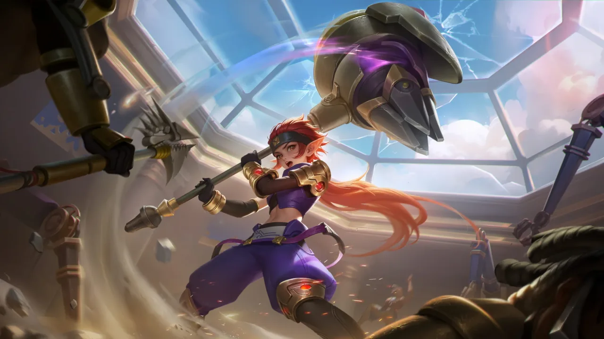

[Тир-лист](https://boostmlbb.ru/heroes/)[Предметы](https://boostmlbb.ru/items/)[Скины](https://boostmlbb.ru/skins/)[Новости и гайды](https://boostmlbb.ru/news/)

[Скины](https://boostmlbb.ru/skins/)/[Лолита](https://boostmlbb.ru/skins/lolita.html)/Солдат-новобранец

[Скин Лолиты](https://boostmlbb.ru/skins/lolita.html)

# Солдат-новобранец

Soldier in Training

Обычный CommonЭлитныйВ продаже

Как получить

Продаётся в магазине обликов за 399 алмазов.

Цена

399 алмазов

Вышел

2016 год

## Что меняет облик

-   Новая внешность
-   Другой цвет эффектов
-   Бонус к характеристикам

## Все скины Лолиты [8](https://boostmlbb.ru/skins/lolita.html)

[Ангельский веерИсключительный · 2025](https://boostmlbb.ru/skins/lolita/angelic-fan.html)[ЗвездочётДелюкс · 2024](https://boostmlbb.ru/skins/lolita/starwatcher.html)[АстромолотИсключительный · 2024](https://boostmlbb.ru/skins/lolita/astro-mallet.html)[Удар генкиИсключительный · 2023](https://boostmlbb.ru/skins/lolita/genki-slam.html)[Спецопе­рацияОбычный · 2020](https://boostmlbb.ru/skins/lolita/special-op.html)[Танец льваИсключительный · 2019](https://boostmlbb.ru/skins/lolita/lion-dance.html)[ПроказницаИсключительный · 2017](https://boostmlbb.ru/skins/lolita/impish-trickster.html)[Солдат-новобранецОбычный · 2016](https://boostmlbb.ru/skins/lolita/soldier-in-training.html)

## Серия «Элитный»

[Золотой османтусЧан'Э · 2026](https://boostmlbb.ru/skins/change/golden-osmanthus.html)[Король-воена­чальникМартис · 2025](https://boostmlbb.ru/skins/martis/warlord-king.html)[Кадет открытого моряКимми · 2024](https://boostmlbb.ru/skins/kimmy/high-seas-cadet.html)[Зелёная копейщицаСильвана · 2024](https://boostmlbb.ru/skins/silvanna/verdant-lancer.html)[Мародёр Кровавое КопытоХилос · 2024](https://boostmlbb.ru/skins/hylos/bloodhoof-marauder.html)[Изящная бабочкаГвиневра · 2024](https://boostmlbb.ru/skins/guinevere/elegant-butterfly.html)[Маркиз клинковЛанселот · 2024](https://boostmlbb.ru/skins/lancelot/marques-of-blades.html)[Привал в пустошахЧип · 2024](https://boostmlbb.ru/skins/chip/badlands-hiatus.html)

**Поднимем ранг на герое Лолита**Цена считается в калькуляторе

[Рассчитать цену](https://boostmlbb.ru/order.html?type=hero)

## Частые вопросы

Как получить скин «Солдат-новобранец» на Лолиту?

Продаётся в магазине обликов за 399 алмазов.

Когда вышел скин «Солдат-новобранец»?

2016 год.

Какой класс у скина «Солдат-новобранец»?

Обычный (Common), серия «Элитный».
