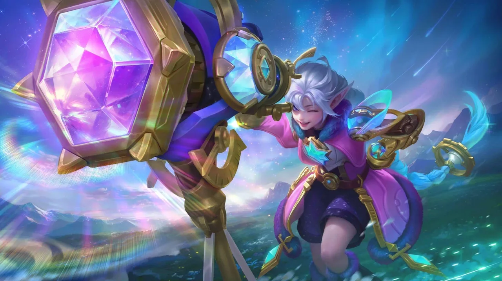
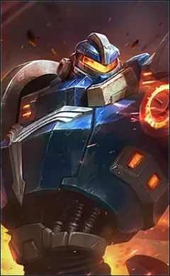

[Тир-лист](https://boostmlbb.ru/heroes/)[Предметы](https://boostmlbb.ru/items/)[Скины](https://boostmlbb.ru/skins/)[Новости и гайды](https://boostmlbb.ru/news/)

[Скины](https://boostmlbb.ru/skins/)/[Лолита](https://boostmlbb.ru/skins/lolita.html)/Звездочёт

[Скин Лолиты](https://boostmlbb.ru/skins/lolita.html)

# Звездочёт

Starwatcher

Делюкс DeluxeRisingОграниченный

Как получить

Награда турнира MLBB Rising Open.

Вышел

5 ноября 2024

## Что меняет облик

-   Новая внешность
-   Новые эффекты навыков
-   Звуки навыков
-   Анимация показа
-   Сцена показа
-   Музыка показа
-   Бонус к характеристикам

## Все скины Лолиты [8](https://boostmlbb.ru/skins/lolita.html)

[Ангельский веерИсключительный · 2025](https://boostmlbb.ru/skins/lolita/angelic-fan.html)[ЗвездочётДелюкс · 2024](https://boostmlbb.ru/skins/lolita/starwatcher.html)[АстромолотИсключительный · 2024](https://boostmlbb.ru/skins/lolita/astro-mallet.html)[Удар генкиИсключительный · 2023](https://boostmlbb.ru/skins/lolita/genki-slam.html)[Спецопе­рацияОбычный · 2020](https://boostmlbb.ru/skins/lolita/special-op.html)[Танец льваИсключительный · 2019](https://boostmlbb.ru/skins/lolita/lion-dance.html)[ПроказницаИсключительный · 2017](https://boostmlbb.ru/skins/lolita/impish-trickster.html)[Солдат-новобранецОбычный · 2016](https://boostmlbb.ru/skins/lolita/soldier-in-training.html)

## Серия «Rising»

[Механи­ческий защитникУранус · 2019](https://boostmlbb.ru/skins/uranus/mech-protector.html)

**Поднимем ранг на герое Лолита**Цена считается в калькуляторе

[Рассчитать цену](https://boostmlbb.ru/order.html?type=hero)

## Частые вопросы

Как получить скин «Звездочёт» на Лолиту?

Награда турнира MLBB Rising Open.

Когда вышел скин «Звездочёт»?

5 ноября 2024.

Какой класс у скина «Звездочёт»?

Делюкс (Deluxe), серия «Rising».
