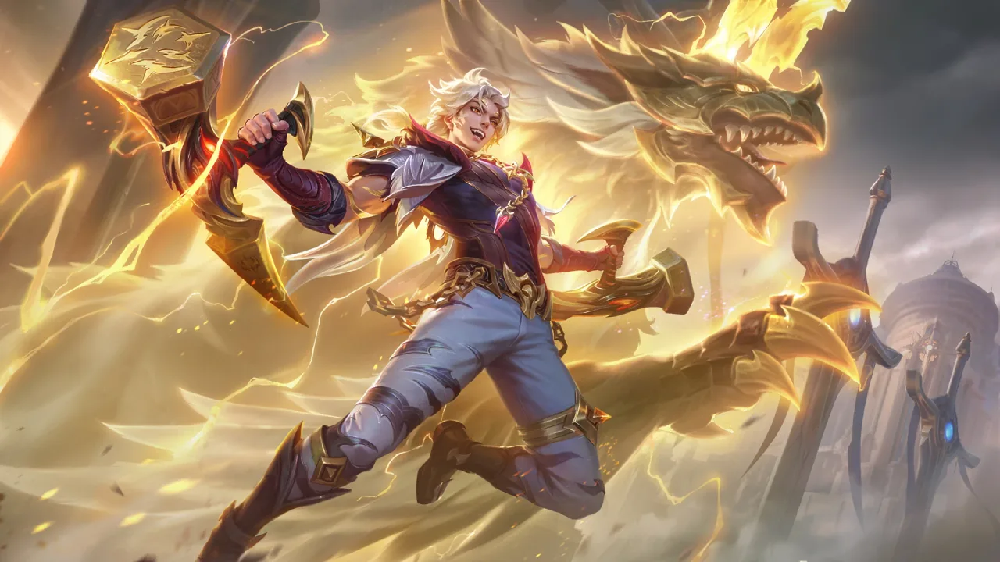

[Все скины](https://boostmlbb.ru/skins/)

[Скины](https://boostmlbb.ru/skins/)/Лукас

# Скины Лукаса

Скинов

2

Можно купить

1

Последний

[Наруто Узумаки](https://boostmlbb.ru/skins/lukas/naruto-uzumaki.html)2025

[Профиль героя→](https://boostmlbb.ru/heroes/lukas.html)

## Все скины

[Наруто УзумакиГрандиозный · 2025](https://boostmlbb.ru/skins/lukas/naruto-uzumaki.html)[Пылкий рёвОбычный · 2024](https://boostmlbb.ru/skins/lukas/ardent-roar.html)

**Сколько стоит буст на герое Лукас?**Выберите текущий и желаемый ранг. Стоимость появится на сайте.

[Рассчитать цену](https://boostmlbb.ru/order.html?type=hero)

## Частые вопросы

Сколько скинов у Лукаса?

2 скина без стандартного облика. Последний — «Наруто Узумаки» (Naruto Uzumaki), 2 мая 2025.

Какие скины Лукаса можно купить сейчас?

«Пылкий рёв» (269 алмазов). Остальные облики ограниченные и возвращаются только в событиях.

Какой самый редкий скин Лукаса?

«Наруто Узумаки» (Naruto Uzumaki), класс грандиозный, серия «Наруто». Выходил в событии коллаборации MLBB × Наруто. Ограниченные облики иногда возвращаются в розыгрышах событий.
