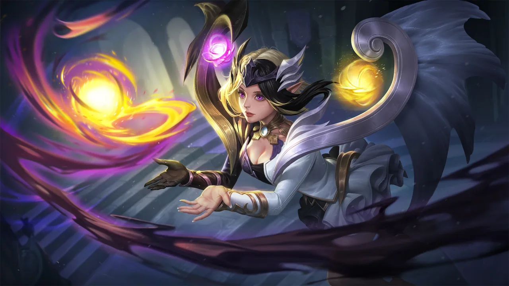

[Тир-лист](https://boostmlbb.ru/heroes/)[Предметы](https://boostmlbb.ru/items/)[Скины](https://boostmlbb.ru/skins/)[Новости и гайды](https://boostmlbb.ru/news/)

[Скины](https://boostmlbb.ru/skins/)/Люнокс

# Скины Люнокс

Скинов

10

Можно купить

6

Последний

[Квантовая полярность](https://boostmlbb.ru/skins/lunox/quantum-polarity.html)2025

[Профиль героя→](https://boostmlbb.ru/heroes/lunox.html)

## Все скины

ВсеВысшийИзысканныйДелюксИсключительныйОбычный

[Квантовая полярностьИсключительный · 2025](https://boostmlbb.ru/skins/lunox/quantum-polarity.html)[Серафим-бабочкаИзысканный · 2025](https://boostmlbb.ru/skins/lunox/butterfly-seraphim.html)[Гармония природыОбычный · 2023](https://boostmlbb.ru/skins/lunox/nature-s-harmony.html)[Божествен­ная богиняВысший · 2023](https://boostmlbb.ru/skins/lunox/divine-goddess.html)[Кровавая МэриОбычный · 2022](https://boostmlbb.ru/skins/lunox/bloody-mary.html)[ВесыДелюкс · 2019](https://boostmlbb.ru/skins/lunox/libra.html)[Откровение зариДелюкс · 2019](https://boostmlbb.ru/skins/lunox/dawn-revelation.html)[Глаза вечностиДелюкс · 2019](https://boostmlbb.ru/skins/lunox/eyes-of-eternity.html)[Пепельный цветИсключительный · 2019](https://boostmlbb.ru/skins/lunox/ash-blossom.html)[Косми­ческая гармонияОбычный · 2019](https://boostmlbb.ru/skins/lunox/cosmic-harmony.html)

**Поднимем ранг на герое Люнокс**Цена считается в калькуляторе

[Рассчитать цену](https://boostmlbb.ru/order.html?type=hero)

## Частые вопросы

Сколько скинов у Люнокс?

10 скинов без стандартного облика. Последний — «Квантовая полярность» (Quantum Polarity), 26 сентября 2025.

Какие скины Люнокс можно купить сейчас?

«Квантовая полярность» (749 алмазов), «Кровавая Мэри» (269 алмазов), «Откровение зари» (899 алмазов), «Глаза вечности» (899 алмазов), «Космическая гармония» (599 алмазов). Остальные облики ограниченные и возвращаются только в событиях.

Какой самый редкий скин Люнокс?

«Божественная богиня» (Divine Goddess), класс высший, серия «Легендарный». Обменивается на 200 магических кристаллов из Магического колеса.
