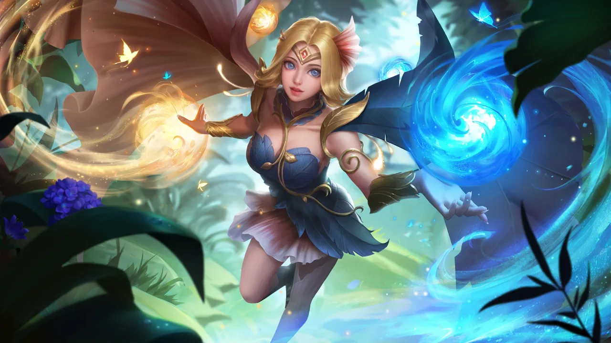
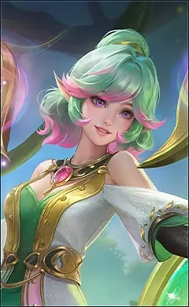

[Тир-лист](https://boostmlbb.ru/heroes/)[Предметы](https://boostmlbb.ru/items/)[Скины](https://boostmlbb.ru/skins/)[Новости и гайды](https://boostmlbb.ru/news/)

[Скины](https://boostmlbb.ru/skins/)/[Люнокс](https://boostmlbb.ru/skins/lunox.html)/Пепельный цвет

[Скин Люнокс](https://boostmlbb.ru/skins/lunox.html)

# Пепельный цвет

Ash Blossom

Исключительный ExceptionalЗвёздный участникОграниченный

Как получить

Награда «Звёздного участника» в мае 2019.

Вышел

1 мая 2019

## Что меняет облик

-   Новая внешность
-   Новые эффекты навыков
-   Анимация показа
-   Бонус к характеристикам

## Все скины Люнокс [10](https://boostmlbb.ru/skins/lunox.html)

[Квантовая полярностьИсключительный · 2025](https://boostmlbb.ru/skins/lunox/quantum-polarity.html)[Серафим-бабочкаИзысканный · 2025](https://boostmlbb.ru/skins/lunox/butterfly-seraphim.html)[Гармония природыОбычный · 2023](https://boostmlbb.ru/skins/lunox/nature-s-harmony.html)[Божествен­ная богиняВысший · 2023](https://boostmlbb.ru/skins/lunox/divine-goddess.html)[Кровавая МэриОбычный · 2022](https://boostmlbb.ru/skins/lunox/bloody-mary.html)[ВесыДелюкс · 2019](https://boostmlbb.ru/skins/lunox/libra.html)[Откровение зариДелюкс · 2019](https://boostmlbb.ru/skins/lunox/dawn-revelation.html)[Глаза вечностиДелюкс · 2019](https://boostmlbb.ru/skins/lunox/eyes-of-eternity.html)[Пепельный цветИсключительный · 2019](https://boostmlbb.ru/skins/lunox/ash-blossom.html)[Косми­ческая гармонияОбычный · 2019](https://boostmlbb.ru/skins/lunox/cosmic-harmony.html)

## Серия «Звёздный участник»

[Морячка, рождённая приливомКалеа · 2026](https://boostmlbb.ru/skins/kalea/tideborn-sailor.html)[Тень кицунэХаябуса · 2026](https://boostmlbb.ru/skins/hayabusa/kitsune-s-shadow.html)[Клыки резниХанзо · 2026](https://boostmlbb.ru/skins/hanzo/fangs-of-slaughter.html)[Тлеющая крепостьБелерик · 2026](https://boostmlbb.ru/skins/belerick/smouldering-fortress.html)[Магитех­нический призракОбсидия · 2026](https://boostmlbb.ru/skins/obsidia/magitech-wraith.html)[Элизийское сияниеЦзэтянь · 2026](https://boostmlbb.ru/skins/zetian/elysian-luminance.html)[Батальон стражейХильда · 2026](https://boostmlbb.ru/skins/hilda/guardian-battalion.html)[Мечта­тельный коиХарли · 2026](https://boostmlbb.ru/skins/harley/dreaming-koi.html)

**Поднимем ранг на герое Люнокс**Цена считается в калькуляторе

[Рассчитать цену](https://boostmlbb.ru/order.html?type=hero)

## Частые вопросы

Как получить скин «Пепельный цвет» на Люнокс?

Награда «Звёздного участника» в мае 2019.

Когда вышел скин «Пепельный цвет»?

1 мая 2019.

Какой класс у скина «Пепельный цвет»?

Исключительный (Exceptional), серия «Звёздный участник».
