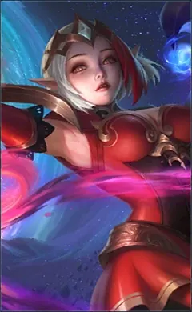

[Тир-лист](https://boostmlbb.ru/heroes/)[Предметы](https://boostmlbb.ru/items/)[Скины](https://boostmlbb.ru/skins/)[Новости и гайды](https://boostmlbb.ru/news/)

[Скины](https://boostmlbb.ru/skins/)/[Люнокс](https://boostmlbb.ru/skins/lunox.html)/Кровавая Мэри

[Скин Люнокс](https://boostmlbb.ru/skins/lunox.html)

# Кровавая Мэри

Bloody Mary

Обычный CommonВ продаже

Как получить

Продаётся в магазине обликов за 269 алмазов.

Цена

269 алмазов

Вышел

22 февраля 2022

## Что меняет облик

-   Бонус к характеристикам

## Все скины Люнокс [10](https://boostmlbb.ru/skins/lunox.html)

[Квантовая полярностьИсключительный · 2025](https://boostmlbb.ru/skins/lunox/quantum-polarity.html)[Серафим-бабочкаИзысканный · 2025](https://boostmlbb.ru/skins/lunox/butterfly-seraphim.html)[Гармония природыОбычный · 2023](https://boostmlbb.ru/skins/lunox/nature-s-harmony.html)[Божествен­ная богиняВысший · 2023](https://boostmlbb.ru/skins/lunox/divine-goddess.html)[Кровавая МэриОбычный · 2022](https://boostmlbb.ru/skins/lunox/bloody-mary.html)[ВесыДелюкс · 2019](https://boostmlbb.ru/skins/lunox/libra.html)[Откровение зариДелюкс · 2019](https://boostmlbb.ru/skins/lunox/dawn-revelation.html)[Глаза вечностиДелюкс · 2019](https://boostmlbb.ru/skins/lunox/eyes-of-eternity.html)[Пепельный цветИсключительный · 2019](https://boostmlbb.ru/skins/lunox/ash-blossom.html)[Косми­ческая гармонияОбычный · 2019](https://boostmlbb.ru/skins/lunox/cosmic-harmony.html)

**Поднимем ранг на герое Люнокс**Цена считается в калькуляторе

[Рассчитать цену](https://boostmlbb.ru/order.html?type=hero)

## Частые вопросы

Как получить скин «Кровавая Мэри» на Люнокс?

Продаётся в магазине обликов за 269 алмазов.

Когда вышел скин «Кровавая Мэри»?

22 февраля 2022.

Какой класс у скина «Кровавая Мэри»?

Обычный (Common).
