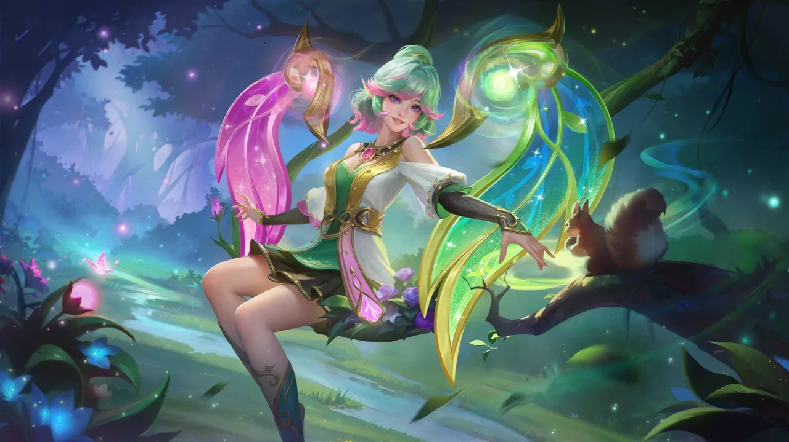

[Скины Люнокс](https://boostmlbb.ru/skins/lunox.html)

[Скины](https://boostmlbb.ru/skins/)/[Люнокс](https://boostmlbb.ru/skins/lunox.html)/Гармония природы

[Скин Люнокс](https://boostmlbb.ru/skins/lunox.html)

# Гармония природы

Nature's Harmony

Обычный CommonЭлитныйОграниченный

Как получить

Подарок за первое пополнение в сезоне 33.

Вышел

18 февраля 2023

## Что меняет облик

-   Новая внешность
-   Другой цвет эффектов
-   Анимация показа
-   Бонус к характеристикам

## Все скины Люнокс [10](https://boostmlbb.ru/skins/lunox.html)

[Квантовая полярностьИсключительный · 2025](https://boostmlbb.ru/skins/lunox/quantum-polarity.html)[Серафим-бабочкаИзысканный · 2025](https://boostmlbb.ru/skins/lunox/butterfly-seraphim.html)[Гармония природыОбычный · 2023](https://boostmlbb.ru/skins/lunox/nature-s-harmony.html)[Божествен­ная богиняВысший · 2023](https://boostmlbb.ru/skins/lunox/divine-goddess.html)[Кровавая МэриОбычный · 2022](https://boostmlbb.ru/skins/lunox/bloody-mary.html)[ВесыДелюкс · 2019](https://boostmlbb.ru/skins/lunox/libra.html)[Откровение зариДелюкс · 2019](https://boostmlbb.ru/skins/lunox/dawn-revelation.html)[Глаза вечностиДелюкс · 2019](https://boostmlbb.ru/skins/lunox/eyes-of-eternity.html)[Пепельный цветИсключительный · 2019](https://boostmlbb.ru/skins/lunox/ash-blossom.html)[Косми­ческая гармонияОбычный · 2019](https://boostmlbb.ru/skins/lunox/cosmic-harmony.html)

## Серия «Элитный»

[Золотой османтусЧан'Э · 2026](https://boostmlbb.ru/skins/change/golden-osmanthus.html)[Король-воена­чальникМартис · 2025](https://boostmlbb.ru/skins/martis/warlord-king.html)[Кадет открытого моряКимми · 2024](https://boostmlbb.ru/skins/kimmy/high-seas-cadet.html)[Зелёная копейщицаСильвана · 2024](https://boostmlbb.ru/skins/silvanna/verdant-lancer.html)[Мародёр Кровавое КопытоХилос · 2024](https://boostmlbb.ru/skins/hylos/bloodhoof-marauder.html)[Изящная бабочкаГвиневра · 2024](https://boostmlbb.ru/skins/guinevere/elegant-butterfly.html)[Маркиз клинковЛанселот · 2024](https://boostmlbb.ru/skins/lancelot/marques-of-blades.html)[Привал в пустошахЧип · 2024](https://boostmlbb.ru/skins/chip/badlands-hiatus.html)

**Сколько стоит буст на герое Люнокс?**Выберите текущий и желаемый ранг. Стоимость появится на сайте.

[Рассчитать цену](https://boostmlbb.ru/order.html?type=hero)

## Частые вопросы

Как получить скин «Гармония природы» на Люнокс?

Подарок за первое пополнение в сезоне 33.

Когда вышел скин «Гармония природы»?

18 февраля 2023.

Какой класс у скина «Гармония природы»?

Обычный (Common), серия «Элитный».
