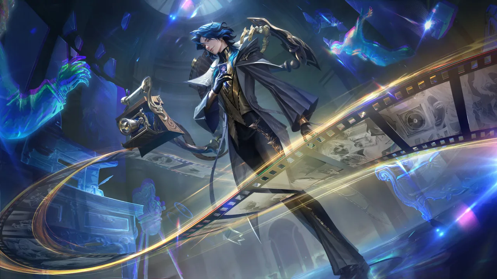
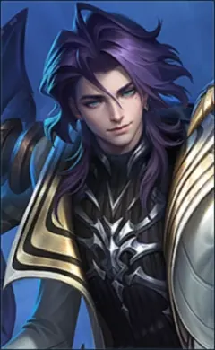

[Все скины](https://boostmlbb.ru/skins/)

[Скины](https://boostmlbb.ru/skins/)/Марсель

# Скины Марселя

Скинов

1

Можно купить

1

Последний

[Расколотые тени](https://boostmlbb.ru/skins/marcel/split-shadows.html)2026

[Профиль героя→](https://boostmlbb.ru/heroes/marcel.html)

## Все скины

[Расколотые тениОбычный · 2026](https://boostmlbb.ru/skins/marcel/split-shadows.html)

**Сколько стоит буст на герое Марсель?**Выберите текущий и желаемый ранг. Стоимость появится на сайте.

[Рассчитать цену](https://boostmlbb.ru/order.html?type=hero)

## Частые вопросы

Сколько скинов у Марселя?

1 скин без стандартного облика. Последний — «Расколотые тени» (Split Shadows), 21 марта 2026.

Какие скины Марселя можно купить сейчас?

«Расколотые тени» (269 алмазов). Остальные облики ограниченные и возвращаются только в событиях.

Какой самый редкий скин Марселя?

«Расколотые тени» (Split Shadows), класс обычный. Продаётся в магазине обликов за 269 алмазов.
