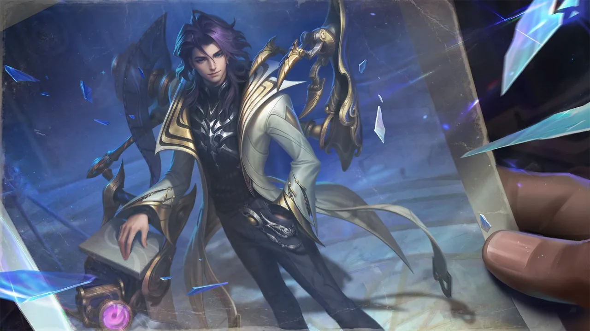

[Скины Марселя](https://boostmlbb.ru/skins/marcel.html)

[Скины](https://boostmlbb.ru/skins/)/[Марсель](https://boostmlbb.ru/skins/marcel.html)/Расколотые тени

[Скин Марселя](https://boostmlbb.ru/skins/marcel.html)

# Расколотые тени

Split Shadows

Обычный CommonВ продаже

Как получить

Продаётся в магазине обликов за 269 алмазов.

Цена

269 алмазов

Вышел

21 марта 2026

## Что меняет облик

-   Бонус к характеристикам

**Сколько стоит буст на герое Марсель?**Выберите текущий и желаемый ранг. Стоимость появится на сайте.

[Рассчитать цену](https://boostmlbb.ru/order.html?type=hero)

## Частые вопросы

Как получить скин «Расколотые тени» на Марселя?

Продаётся в магазине обликов за 269 алмазов.

Когда вышел скин «Расколотые тени»?

21 марта 2026.

Какой класс у скина «Расколотые тени»?

Обычный (Common).
