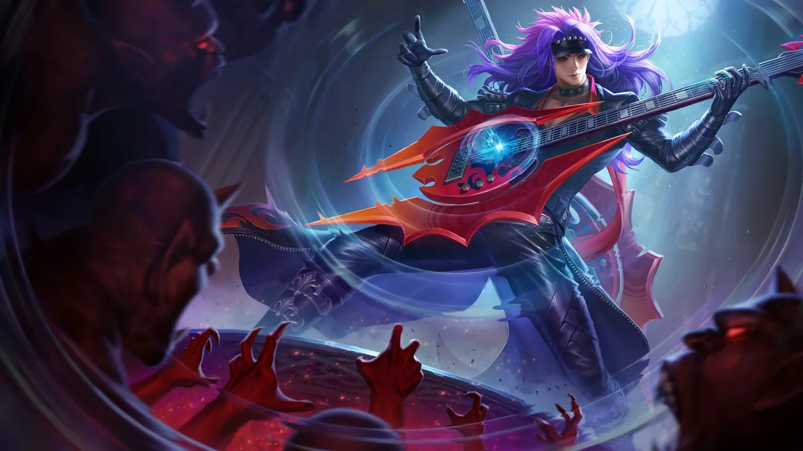

[Тир-лист](https://boostmlbb.ru/heroes/)[Предметы](https://boostmlbb.ru/items/)[Скины](https://boostmlbb.ru/skins/)[Новости и гайды](https://boostmlbb.ru/news/)

[Скины](https://boostmlbb.ru/skins/)/[Мартис](https://boostmlbb.ru/skins/martis.html)/Дэтрок

[Скин Мартиса](https://boostmlbb.ru/skins/martis.html)

# Дэтрок

Deathrock

Исключительный ExceptionalОсобыйОграниченный

Как получить

Выходил в магазине обликов во время события. Ограниченные облики иногда возвращаются в розыгрышах событий.

Вышел

6 января 2022

## Что меняет облик

-   Новая внешность
-   Новые эффекты навыков
-   Анимация показа
-   Бонус к характеристикам

## Все скины Мартиса [9](https://boostmlbb.ru/skins/martis.html)

[Король-воена­чальникОбычный · 2025](https://boostmlbb.ru/skins/martis/warlord-king.html)[Ужас тёмных водИсключительный · 2024](https://boostmlbb.ru/skins/martis/darkwater-terror.html)[ЛевиГрандиозный · 2024](https://boostmlbb.ru/skins/martis/levi.html)[КозерогДелюкс · 2022](https://boostmlbb.ru/skins/martis/capricorn.html)[ДэтрокИсключительный · 2022](https://boostmlbb.ru/skins/martis/deathrock.html)[Бог войныИзысканный · 2020](https://boostmlbb.ru/skins/martis/god-of-war.html)[Обжигающая пастьИсключительный · 2018](https://boostmlbb.ru/skins/martis/searing-maw.html)[ТиранОбычный · 2018](https://boostmlbb.ru/skins/martis/tyrant.html)[Дикий отступник](https://boostmlbb.ru/skins/martis/wild-renegade.html)

## Серия «Особый»

[Тайный вердиктМатильда · 2026](https://boostmlbb.ru/skins/mathilda/arcane-verdict.html)[Вальс на ветруВэйл · 2026](https://boostmlbb.ru/skins/vale/windborne-waltz.html)[Капитан потерянныхФранко · 2026](https://boostmlbb.ru/skins/franco/captain-of-the-lost.html)[ВолнорезЛи Сун-Син · 2025](https://boostmlbb.ru/skins/yi-sun-shin/wavebreaker.html)[Стальные рукиБаданг · 2025](https://boostmlbb.ru/skins/badang/steel-arms.html)[Леди с зонтикомКагура · 2025](https://boostmlbb.ru/skins/kagura/lady-parasol.html)[Ужас пучиныАлдос · 2025](https://boostmlbb.ru/skins/aldous/fathom-terror.html)[Труппа лунного светаЧан'Э · 2025](https://boostmlbb.ru/skins/change/moonglow-troupe.html)

**Поднимем ранг на герое Мартис**Цена считается в калькуляторе

[Рассчитать цену](https://boostmlbb.ru/order.html?type=hero)

## Частые вопросы

Как получить скин «Дэтрок» на Мартиса?

Выходил в магазине обликов во время события. Ограниченные облики иногда возвращаются в розыгрышах событий.

Когда вышел скин «Дэтрок»?

6 января 2022.

Какой класс у скина «Дэтрок»?

Исключительный (Exceptional), серия «Особый».
