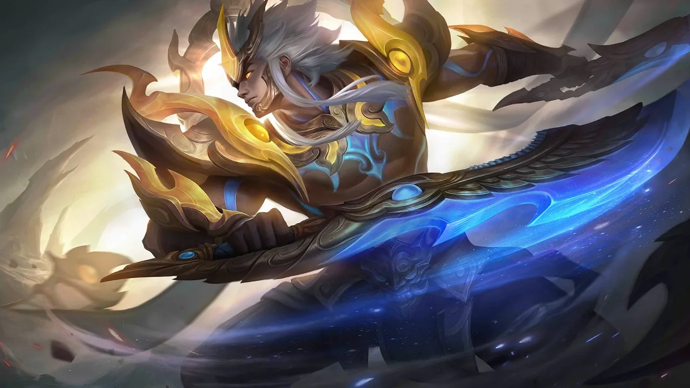

[Тир-лист](https://boostmlbb.ru/heroes/)[Предметы](https://boostmlbb.ru/items/)[Скины](https://boostmlbb.ru/skins/)[Новости и гайды](https://boostmlbb.ru/news/)

[Скины](https://boostmlbb.ru/skins/)/[Мартис](https://boostmlbb.ru/skins/martis.html)/Бог войны

[Скин Мартиса](https://boostmlbb.ru/skins/martis.html)

# Бог войны

God of War

Изысканный ExquisiteЯщик удачиОграниченный

Как получить

Выпадал из ящиков удачи в событиях. Ограниченные облики иногда возвращаются в розыгрышах событий.

Вышел

3 января 2020

## Что меняет облик

-   Новая внешность
-   Новые эффекты навыков
-   Звуки навыков
-   Своя озвучка
-   Анимация показа
-   Сцена показа
-   Особые действия
-   Бонус к характеристикам

## Все скины Мартиса [9](https://boostmlbb.ru/skins/martis.html)

[Король-воена­чальникОбычный · 2025](https://boostmlbb.ru/skins/martis/warlord-king.html)[Ужас тёмных водИсключительный · 2024](https://boostmlbb.ru/skins/martis/darkwater-terror.html)[ЛевиГрандиозный · 2024](https://boostmlbb.ru/skins/martis/levi.html)[КозерогДелюкс · 2022](https://boostmlbb.ru/skins/martis/capricorn.html)[ДэтрокИсключительный · 2022](https://boostmlbb.ru/skins/martis/deathrock.html)[Бог войныИзысканный · 2020](https://boostmlbb.ru/skins/martis/god-of-war.html)[Обжигающая пастьИсключительный · 2018](https://boostmlbb.ru/skins/martis/searing-maw.html)[ТиранОбычный · 2018](https://boostmlbb.ru/skins/martis/tyrant.html)[Дикий отступник](https://boostmlbb.ru/skins/martis/wild-renegade.html)

## Серия «Ящик удачи»

[Леди-журавльГвиневра · 2025](https://boostmlbb.ru/skins/guinevere/lady-crane.html)[Серафим-бабочкаЛюнокс · 2025](https://boostmlbb.ru/skins/lunox/butterfly-seraphim.html)[МехадраконКлауд · 2025](https://boostmlbb.ru/skins/claude/mecha-dragon.html)[Лунная магияЧан'Э · 2020](https://boostmlbb.ru/skins/change/lunar-magic.html)[Громовая вспышкаСелена · 2020](https://boostmlbb.ru/skins/selena/thunder-flash.html)[РакшасаХанаби · 2020](https://boostmlbb.ru/skins/hanabi/rakshesha.html)[Повелитель видеоигрУранус · 2020](https://boostmlbb.ru/skins/uranus/video-game-dominator.html)[Владыка ВальгаллыФранко · 2020](https://boostmlbb.ru/skins/franco/valhalla-ruler.html)

**Поднимем ранг на герое Мартис**Цена считается в калькуляторе

[Рассчитать цену](https://boostmlbb.ru/order.html?type=hero)

## Частые вопросы

Как получить скин «Бог войны» на Мартиса?

Выпадал из ящиков удачи в событиях. Ограниченные облики иногда возвращаются в розыгрышах событий.

Когда вышел скин «Бог войны»?

3 января 2020.

Какой класс у скина «Бог войны»?

Изысканный (Exquisite), серия «Ящик удачи».
