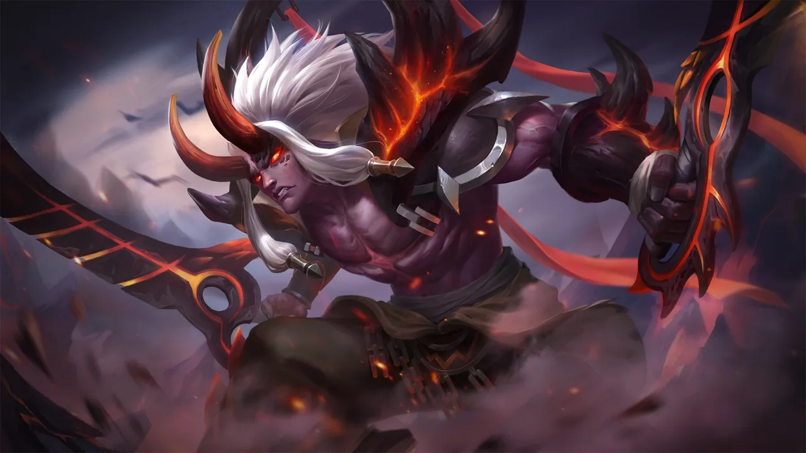

[Тир-лист](https://boostmlbb.ru/heroes/)[Предметы](https://boostmlbb.ru/items/)[Скины](https://boostmlbb.ru/skins/)[Новости и гайды](https://boostmlbb.ru/news/)

[Скины](https://boostmlbb.ru/skins/)/[Мартис](https://boostmlbb.ru/skins/martis.html)/Обжигающая пасть

[Скин Мартиса](https://boostmlbb.ru/skins/martis.html)

# Обжигающая пасть

Searing Maw

Исключительный ExceptionalЗвёздный участникОграниченный

Как получить

Награда «Звёздного участника» в мае 2018.

Вышел

1 мая 2018

## Что меняет облик

-   Новая внешность
-   Новые эффекты навыков
-   Анимация показа
-   Бонус к характеристикам

## Все скины Мартиса [9](https://boostmlbb.ru/skins/martis.html)

[Король-воена­чальникОбычный · 2025](https://boostmlbb.ru/skins/martis/warlord-king.html)[Ужас тёмных водИсключительный · 2024](https://boostmlbb.ru/skins/martis/darkwater-terror.html)[ЛевиГрандиозный · 2024](https://boostmlbb.ru/skins/martis/levi.html)[КозерогДелюкс · 2022](https://boostmlbb.ru/skins/martis/capricorn.html)[ДэтрокИсключительный · 2022](https://boostmlbb.ru/skins/martis/deathrock.html)[Бог войныИзысканный · 2020](https://boostmlbb.ru/skins/martis/god-of-war.html)[Обжигающая пастьИсключительный · 2018](https://boostmlbb.ru/skins/martis/searing-maw.html)[ТиранОбычный · 2018](https://boostmlbb.ru/skins/martis/tyrant.html)[Дикий отступник](https://boostmlbb.ru/skins/martis/wild-renegade.html)

## Серия «Звёздный участник»

[Морячка, рождённая приливомКалеа · 2026](https://boostmlbb.ru/skins/kalea/tideborn-sailor.html)[Тень кицунэХаябуса · 2026](https://boostmlbb.ru/skins/hayabusa/kitsune-s-shadow.html)[Клыки резниХанзо · 2026](https://boostmlbb.ru/skins/hanzo/fangs-of-slaughter.html)[Тлеющая крепостьБелерик · 2026](https://boostmlbb.ru/skins/belerick/smouldering-fortress.html)[Магитех­нический призракОбсидия · 2026](https://boostmlbb.ru/skins/obsidia/magitech-wraith.html)[Элизийское сияниеЦзэтянь · 2026](https://boostmlbb.ru/skins/zetian/elysian-luminance.html)[Батальон стражейХильда · 2026](https://boostmlbb.ru/skins/hilda/guardian-battalion.html)[Мечта­тельный коиХарли · 2026](https://boostmlbb.ru/skins/harley/dreaming-koi.html)

**Поднимем ранг на герое Мартис**Цена считается в калькуляторе

[Рассчитать цену](https://boostmlbb.ru/order.html?type=hero)

## Частые вопросы

Как получить скин «Обжигающая пасть» на Мартиса?

Награда «Звёздного участника» в мае 2018.

Когда вышел скин «Обжигающая пасть»?

1 мая 2018.

Какой класс у скина «Обжигающая пасть»?

Исключительный (Exceptional), серия «Звёздный участник».
