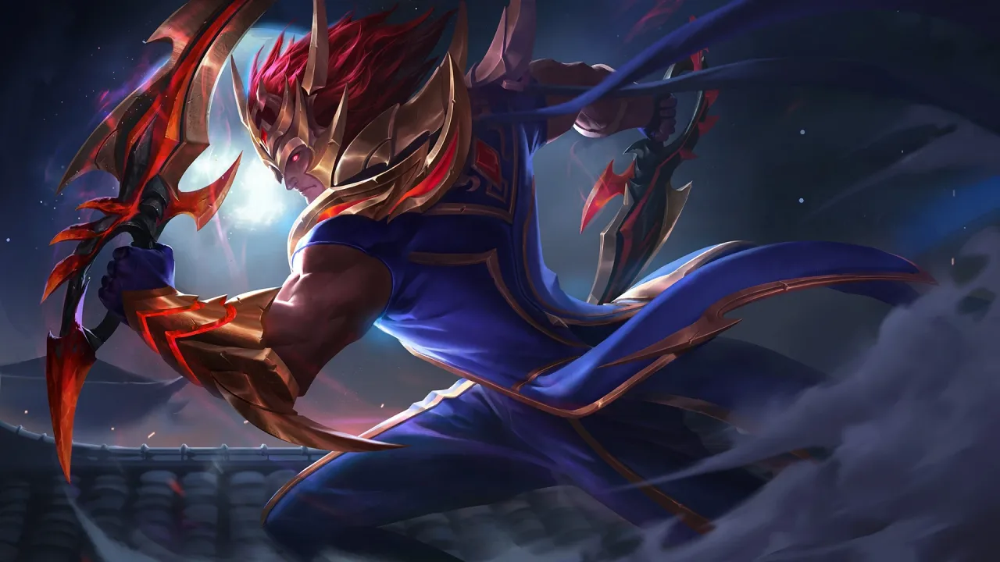
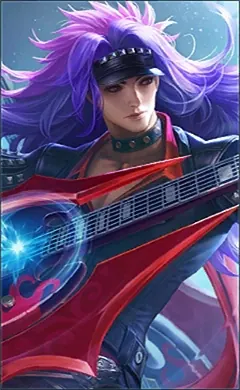

[Скины Мартиса](https://boostmlbb.ru/skins/martis.html)

[Скины](https://boostmlbb.ru/skins/)/[Мартис](https://boostmlbb.ru/skins/martis.html)/Тиран

[Скин Мартиса](https://boostmlbb.ru/skins/martis.html)

# Тиран

Tyrant

Обычный CommonВ продаже

Как получить

Продаётся в магазине обликов за 269 алмазов.

Цена

269 алмазов

Вышел

февраль 2018

## Что меняет облик

-   Бонус к характеристикам

## Все скины Мартиса [9](https://boostmlbb.ru/skins/martis.html)

[Король-воена­чальникОбычный · 2025](https://boostmlbb.ru/skins/martis/warlord-king.html)[Ужас тёмных водИсключительный · 2024](https://boostmlbb.ru/skins/martis/darkwater-terror.html)[ЛевиГрандиозный · 2024](https://boostmlbb.ru/skins/martis/levi.html)[КозерогДелюкс · 2022](https://boostmlbb.ru/skins/martis/capricorn.html)[ДэтрокИсключительный · 2022](https://boostmlbb.ru/skins/martis/deathrock.html)[Бог войныИзысканный · 2020](https://boostmlbb.ru/skins/martis/god-of-war.html)[Обжигающая пастьИсключительный · 2018](https://boostmlbb.ru/skins/martis/searing-maw.html)[ТиранОбычный · 2018](https://boostmlbb.ru/skins/martis/tyrant.html)[Дикий отступник](https://boostmlbb.ru/skins/martis/wild-renegade.html)

**Сколько стоит буст на герое Мартис?**Выберите текущий и желаемый ранг. Стоимость появится на сайте.

[Рассчитать цену](https://boostmlbb.ru/order.html?type=hero)

## Частые вопросы

Как получить скин «Тиран» на Мартиса?

Продаётся в магазине обликов за 269 алмазов.

Когда вышел скин «Тиран»?

Февраль 2018.

Какой класс у скина «Тиран»?

Обычный (Common).
