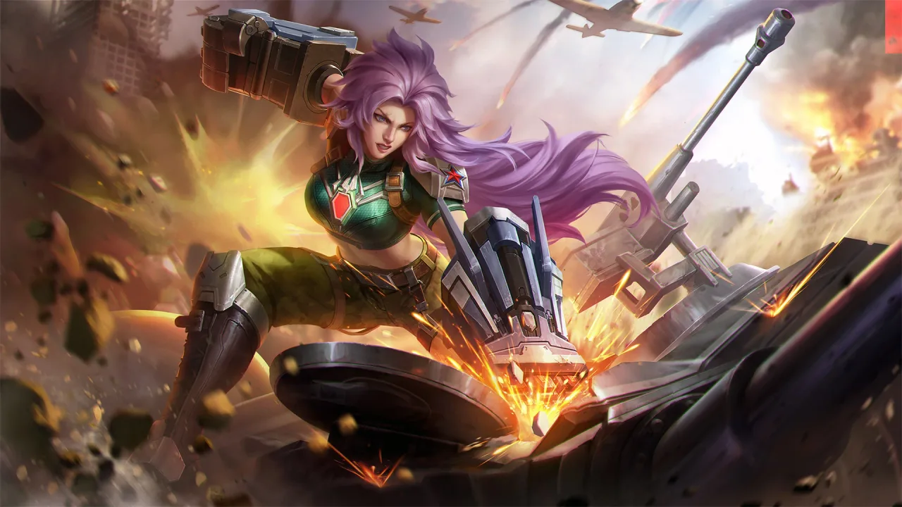

[Скины Маши](https://boostmlbb.ru/skins/masha.html)

[Скины](https://boostmlbb.ru/skins/)/[Маша](https://boostmlbb.ru/skins/masha.html)/Боевая дева

[Скин Маши](https://boostmlbb.ru/skins/masha.html)

# Боевая дева

Combat Maiden

Исключительный ExceptionalЗвёздный участникОграниченный

Как получить

Награда «Звёздного участника» в феврале 2020.

Вышел

1 февраля 2020

## Что меняет облик

-   Новая внешность
-   Новые эффекты навыков
-   Анимация показа
-   Бонус к характеристикам

## Все скины Маши [6](https://boostmlbb.ru/skins/masha.html)

[Май ШирануиГрандиозный · 2024](https://boostmlbb.ru/skins/masha/mai-shiranui.html)[Коготь разбойницыИсключительный · 2022](https://boostmlbb.ru/skins/masha/rogue-talon.html)[Бойкая перчаткаОбычный · 2020](https://boostmlbb.ru/skins/masha/spirited-gauntlet.html)[Драконья броняДелюкс · 2020](https://boostmlbb.ru/skins/masha/dragon-armor.html)[Боевая деваИсключительный · 2020](https://boostmlbb.ru/skins/masha/combat-maiden.html)[Зимняя стражаОбычный · 2019](https://boostmlbb.ru/skins/masha/winter-guard.html)

## Серия «Звёздный участник»

[Морячка, рождённая приливомКалеа · 2026](https://boostmlbb.ru/skins/kalea/tideborn-sailor.html)[Тень кицунэХаябуса · 2026](https://boostmlbb.ru/skins/hayabusa/kitsune-s-shadow.html)[Клыки резниХанзо · 2026](https://boostmlbb.ru/skins/hanzo/fangs-of-slaughter.html)[Тлеющая крепостьБелерик · 2026](https://boostmlbb.ru/skins/belerick/smouldering-fortress.html)[Магитех­нический призракОбсидия · 2026](https://boostmlbb.ru/skins/obsidia/magitech-wraith.html)[Элизийское сияниеЦзэтянь · 2026](https://boostmlbb.ru/skins/zetian/elysian-luminance.html)[Батальон стражейХильда · 2026](https://boostmlbb.ru/skins/hilda/guardian-battalion.html)[Мечта­тельный коиХарли · 2026](https://boostmlbb.ru/skins/harley/dreaming-koi.html)

**Сколько стоит буст на герое Маша?**Выберите текущий и желаемый ранг. Стоимость появится на сайте.

[Рассчитать цену](https://boostmlbb.ru/order.html?type=hero)

## Частые вопросы

Как получить скин «Боевая дева» на Машу?

Награда «Звёздного участника» в феврале 2020.

Когда вышел скин «Боевая дева»?

1 февраля 2020.

Какой класс у скина «Боевая дева»?

Исключительный (Exceptional), серия «Звёздный участник».
