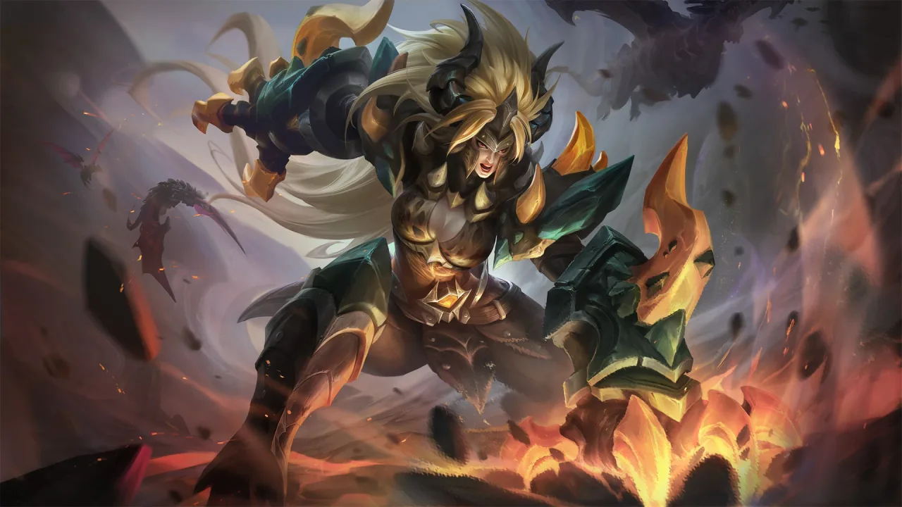
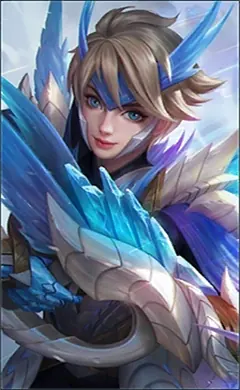

[Тир-лист](https://boostmlbb.ru/heroes/)[Предметы](https://boostmlbb.ru/items/)[Скины](https://boostmlbb.ru/skins/)[Новости и гайды](https://boostmlbb.ru/news/)

[Скины](https://boostmlbb.ru/skins/)/[Маша](https://boostmlbb.ru/skins/masha.html)/Драконья броня

[Скин Маши](https://boostmlbb.ru/skins/masha.html)

# Драконья броня

Dragon Armor

Делюкс DeluxeУкротители драконовВ продаже

Как получить

Продаётся в магазине обликов за 899 алмазов.

Цена

899 алмазов

Вышел

21 июня 2020

## Что меняет облик

-   Новая внешность
-   Новые эффекты навыков
-   Анимация показа
-   Сцена показа
-   Бонус к характеристикам

## Все скины Маши [6](https://boostmlbb.ru/skins/masha.html)

[Май ШирануиГрандиозный · 2024](https://boostmlbb.ru/skins/masha/mai-shiranui.html)[Коготь разбойницыИсключительный · 2022](https://boostmlbb.ru/skins/masha/rogue-talon.html)[Бойкая перчаткаОбычный · 2020](https://boostmlbb.ru/skins/masha/spirited-gauntlet.html)[Драконья броняДелюкс · 2020](https://boostmlbb.ru/skins/masha/dragon-armor.html)[Боевая деваИсключительный · 2020](https://boostmlbb.ru/skins/masha/combat-maiden.html)[Зимняя стражаОбычный · 2019](https://boostmlbb.ru/skins/masha/winter-guard.html)

## Серия «Укротители драконов»

[Морозное крылоКимми · 2025](https://boostmlbb.ru/skins/kimmy/frost-wing.html)[Ночная теньЛинг · 2024](https://boostmlbb.ru/skins/ling/night-shade.html)[Небесное пламяЛанселот · 2021](https://boostmlbb.ru/skins/lancelot/empyrean-flame.html)[Драконье пламяВалир · 2019](https://boostmlbb.ru/skins/valir/draconic-flame.html)[Ротанговый драконЭстес · 2017](https://boostmlbb.ru/skins/estes/rattan-dragon.html)

**Поднимем ранг на герое Маша**Цена считается в калькуляторе

[Рассчитать цену](https://boostmlbb.ru/order.html?type=hero)

## Частые вопросы

Как получить скин «Драконья броня» на Машу?

Продаётся в магазине обликов за 899 алмазов.

Когда вышел скин «Драконья броня»?

21 июня 2020.

Какой класс у скина «Драконья броня»?

Делюкс (Deluxe), серия «Укротители драконов».
