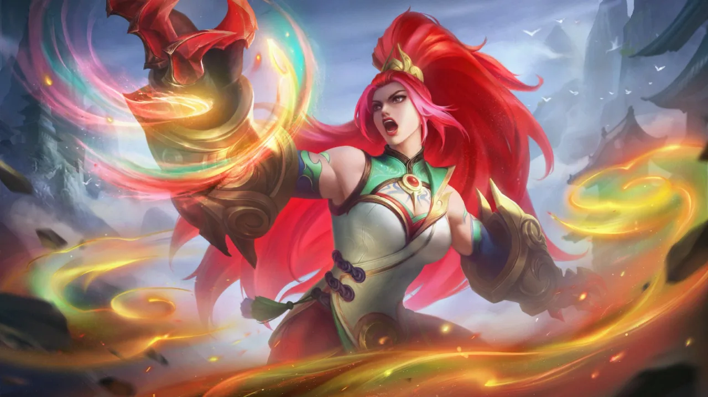
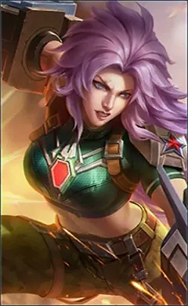

[Тир-лист](https://boostmlbb.ru/heroes/)[Предметы](https://boostmlbb.ru/items/)[Скины](https://boostmlbb.ru/skins/)[Новости и гайды](https://boostmlbb.ru/news/)

[Скины](https://boostmlbb.ru/skins/)/[Маша](https://boostmlbb.ru/skins/masha.html)/Коготь разбойницы

[Скин Маши](https://boostmlbb.ru/skins/masha.html)

# Коготь разбойницы

Rogue Talon

Исключительный ExceptionalОсобыйОграниченный

Как получить

Выходил в магазине обликов во время события. Ограниченные облики иногда возвращаются в розыгрышах событий.

Вышел

28 ноября 2022

## Что меняет облик

-   Новая внешность
-   Новые эффекты навыков
-   Анимация показа
-   Бонус к характеристикам

## Все скины Маши [6](https://boostmlbb.ru/skins/masha.html)

[Май ШирануиГрандиозный · 2024](https://boostmlbb.ru/skins/masha/mai-shiranui.html)[Коготь разбойницыИсключительный · 2022](https://boostmlbb.ru/skins/masha/rogue-talon.html)[Бойкая перчаткаОбычный · 2020](https://boostmlbb.ru/skins/masha/spirited-gauntlet.html)[Драконья броняДелюкс · 2020](https://boostmlbb.ru/skins/masha/dragon-armor.html)[Боевая деваИсключительный · 2020](https://boostmlbb.ru/skins/masha/combat-maiden.html)[Зимняя стражаОбычный · 2019](https://boostmlbb.ru/skins/masha/winter-guard.html)

## Серия «Особый»

[Тайный вердиктМатильда · 2026](https://boostmlbb.ru/skins/mathilda/arcane-verdict.html)[Вальс на ветруВэйл · 2026](https://boostmlbb.ru/skins/vale/windborne-waltz.html)[Капитан потерянныхФранко · 2026](https://boostmlbb.ru/skins/franco/captain-of-the-lost.html)[ВолнорезЛи Сун-Син · 2025](https://boostmlbb.ru/skins/yi-sun-shin/wavebreaker.html)[Стальные рукиБаданг · 2025](https://boostmlbb.ru/skins/badang/steel-arms.html)[Леди с зонтикомКагура · 2025](https://boostmlbb.ru/skins/kagura/lady-parasol.html)[Ужас пучиныАлдос · 2025](https://boostmlbb.ru/skins/aldous/fathom-terror.html)[Труппа лунного светаЧан'Э · 2025](https://boostmlbb.ru/skins/change/moonglow-troupe.html)

**Поднимем ранг на герое Маша**Цена считается в калькуляторе

[Рассчитать цену](https://boostmlbb.ru/order.html?type=hero)

## Частые вопросы

Как получить скин «Коготь разбойницы» на Машу?

Выходил в магазине обликов во время события. Ограниченные облики иногда возвращаются в розыгрышах событий.

Когда вышел скин «Коготь разбойницы»?

28 ноября 2022.

Какой класс у скина «Коготь разбойницы»?

Исключительный (Exceptional), серия «Особый».
