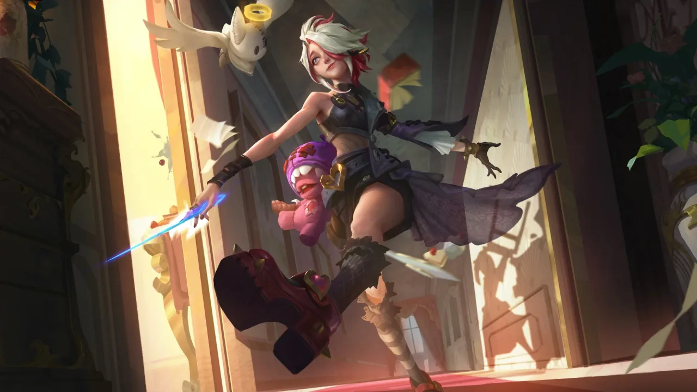

[Тир-лист](https://boostmlbb.ru/heroes/)[Предметы](https://boostmlbb.ru/items/)[Скины](https://boostmlbb.ru/skins/)[Новости и гайды](https://boostmlbb.ru/news/)

[Скины](https://boostmlbb.ru/skins/)/Мелисса

# Скины Мелиссы

Скинов

5

Можно купить

1

Последний

[Цветение тени](https://boostmlbb.ru/skins/melissa/umbra-bloom.html)2025

[Профиль героя→](https://boostmlbb.ru/heroes/melissa.html)

## Все скины

[Цветение тениИзысканный · 2025](https://boostmlbb.ru/skins/melissa/umbra-bloom.html)[Мелисса SPARKLEДелюкс · 2024](https://boostmlbb.ru/skins/melissa/sparkle-melissa.html)[Ночная странницаИсключительный · 2023](https://boostmlbb.ru/skins/melissa/nightwalker.html)[Нобара КугисакиГрандиозный · 2023](https://boostmlbb.ru/skins/melissa/nobara-kugisaki.html)[Ткачиха болиОбычный · 2022](https://boostmlbb.ru/skins/melissa/twinge-weaver.html)

**Поднимем ранг на герое Мелисса**Цена считается в калькуляторе

[Рассчитать цену](https://boostmlbb.ru/order.html?type=hero)

## Частые вопросы

Сколько скинов у Мелиссы?

5 скинов без стандартного облика. Последний — «Цветение тени» (Umbra Bloom), 3 апреля 2025.

Какие скины Мелиссы можно купить сейчас?

«Ткачиха боли» (269 алмазов). Остальные облики ограниченные и возвращаются только в событиях.

Какой самый редкий скин Мелиссы?

«Нобара Кугисаки» (Nobara Kugisaki), класс грандиозный, серия «Магическая битва». Выходил в событии коллаборации MLBB × Jujutsu Kaisen.
