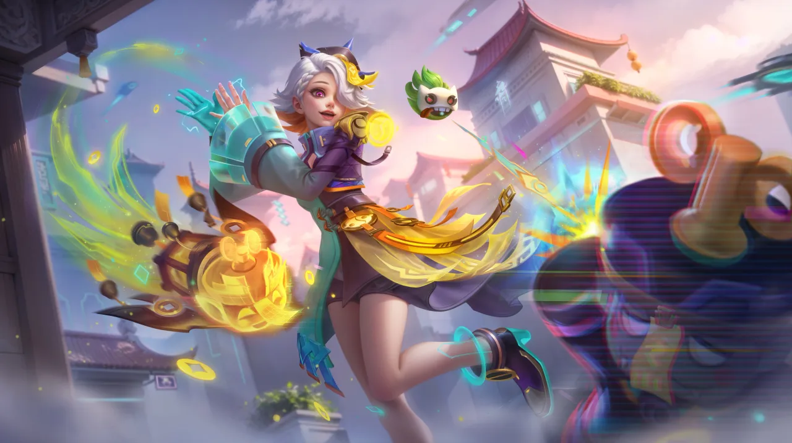

[Тир-лист](https://boostmlbb.ru/heroes/)[Предметы](https://boostmlbb.ru/items/)[Скины](https://boostmlbb.ru/skins/)[Новости и гайды](https://boostmlbb.ru/news/)

[Скины](https://boostmlbb.ru/skins/)/[Мелисса](https://boostmlbb.ru/skins/melissa.html)/Ночная странница

[Скин Мелиссы](https://boostmlbb.ru/skins/melissa.html)

# Ночная странница

Nightwalker

Исключительный ExceptionalЗвёздный участникОграниченный

Как получить

Награда «Звёздного участника» в ноябре 2023.

Вышел

1 ноября 2023

## Что меняет облик

-   Новая внешность
-   Новые эффекты навыков
-   Анимация показа
-   Сцена показа
-   Бонус к характеристикам

## Все скины Мелиссы [5](https://boostmlbb.ru/skins/melissa.html)

[Цветение тениИзысканный · 2025](https://boostmlbb.ru/skins/melissa/umbra-bloom.html)[Мелисса SPARKLEДелюкс · 2024](https://boostmlbb.ru/skins/melissa/sparkle-melissa.html)[Ночная странницаИсключительный · 2023](https://boostmlbb.ru/skins/melissa/nightwalker.html)[Нобара КугисакиГрандиозный · 2023](https://boostmlbb.ru/skins/melissa/nobara-kugisaki.html)[Ткачиха болиОбычный · 2022](https://boostmlbb.ru/skins/melissa/twinge-weaver.html)

## Серия «Звёздный участник»

[Морячка, рождённая приливомКалеа · 2026](https://boostmlbb.ru/skins/kalea/tideborn-sailor.html)[Тень кицунэХаябуса · 2026](https://boostmlbb.ru/skins/hayabusa/kitsune-s-shadow.html)[Клыки резниХанзо · 2026](https://boostmlbb.ru/skins/hanzo/fangs-of-slaughter.html)[Тлеющая крепостьБелерик · 2026](https://boostmlbb.ru/skins/belerick/smouldering-fortress.html)[Магитех­нический призракОбсидия · 2026](https://boostmlbb.ru/skins/obsidia/magitech-wraith.html)[Элизийское сияниеЦзэтянь · 2026](https://boostmlbb.ru/skins/zetian/elysian-luminance.html)[Батальон стражейХильда · 2026](https://boostmlbb.ru/skins/hilda/guardian-battalion.html)[Мечта­тельный коиХарли · 2026](https://boostmlbb.ru/skins/harley/dreaming-koi.html)

**Поднимем ранг на герое Мелисса**Цена считается в калькуляторе

[Рассчитать цену](https://boostmlbb.ru/order.html?type=hero)

## Частые вопросы

Как получить скин «Ночная странница» на Мелиссу?

Награда «Звёздного участника» в ноябре 2023.

Когда вышел скин «Ночная странница»?

1 ноября 2023.

Какой класс у скина «Ночная странница»?

Исключительный (Exceptional), серия «Звёздный участник».
