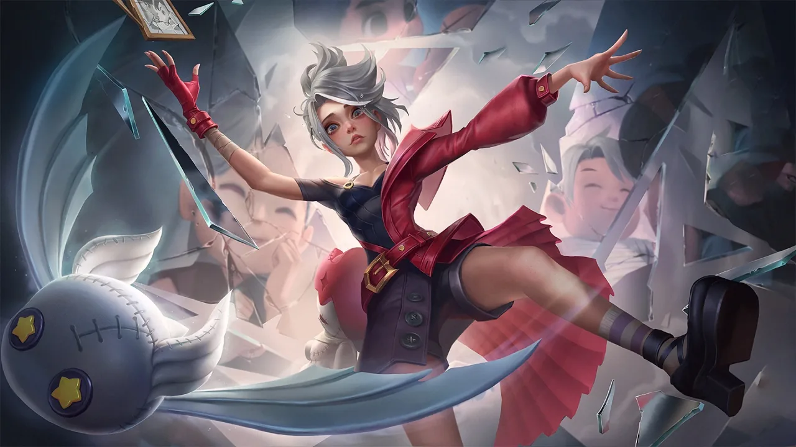

[Скины Мелиссы](https://boostmlbb.ru/skins/melissa.html)

[Скины](https://boostmlbb.ru/skins/)/[Мелисса](https://boostmlbb.ru/skins/melissa.html)/Ткачиха боли

[Скин Мелиссы](https://boostmlbb.ru/skins/melissa.html)

# Ткачиха боли

Twinge Weaver

Обычный CommonВ продаже

Как получить

Продаётся в магазине обликов за 269 алмазов.

Цена

269 алмазов

Вышел

22 февраля 2022

## Что меняет облик

-   Бонус к характеристикам

## Все скины Мелиссы [5](https://boostmlbb.ru/skins/melissa.html)

[Цветение тениИзысканный · 2025](https://boostmlbb.ru/skins/melissa/umbra-bloom.html)[Мелисса SPARKLEДелюкс · 2024](https://boostmlbb.ru/skins/melissa/sparkle-melissa.html)[Ночная странницаИсключительный · 2023](https://boostmlbb.ru/skins/melissa/nightwalker.html)[Нобара КугисакиГрандиозный · 2023](https://boostmlbb.ru/skins/melissa/nobara-kugisaki.html)[Ткачиха болиОбычный · 2022](https://boostmlbb.ru/skins/melissa/twinge-weaver.html)

**Сколько стоит буст на герое Мелисса?**Выберите текущий и желаемый ранг. Стоимость появится на сайте.

[Рассчитать цену](https://boostmlbb.ru/order.html?type=hero)

## Частые вопросы

Как получить скин «Ткачиха боли» на Мелиссу?

Продаётся в магазине обликов за 269 алмазов.

Когда вышел скин «Ткачиха боли»?

22 февраля 2022.

Какой класс у скина «Ткачиха боли»?

Обычный (Common).
