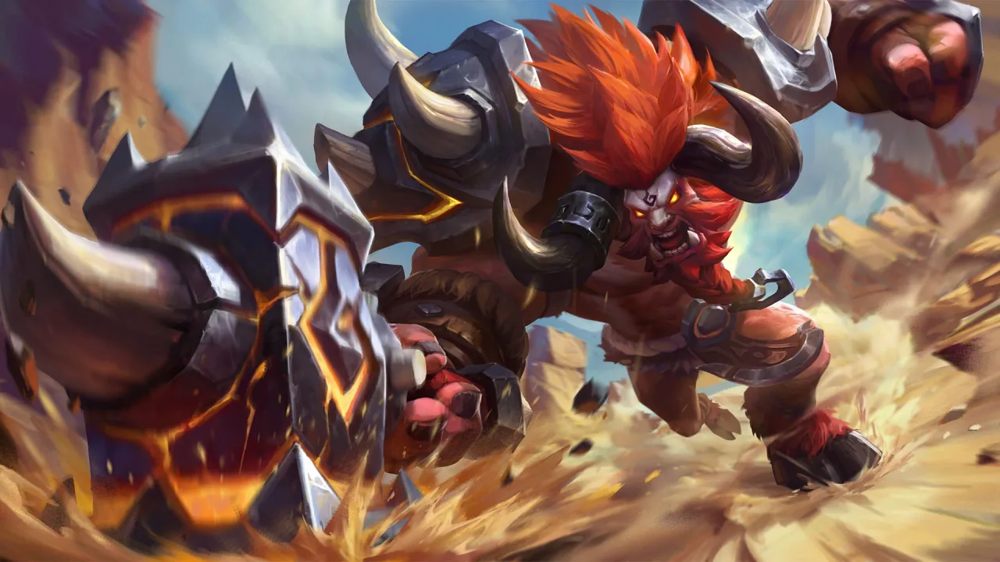

[Тир-лист](https://boostmlbb.ru/heroes/)[Предметы](https://boostmlbb.ru/items/)[Скины](https://boostmlbb.ru/skins/)[Новости и гайды](https://boostmlbb.ru/news/)

[Скины](https://boostmlbb.ru/skins/)/Минотавр

# Скины Минотавра

Скинов

6

Можно купить

3

Последний

[Надзи­ратель преис­подней](https://boostmlbb.ru/skins/minotaur/nether-overseer.html)2026

[Профиль героя→](https://boostmlbb.ru/heroes/minotaur.html)

## Все скины

[Надзи­ратель преис­поднейДелюкс · 2026](https://boostmlbb.ru/skins/minotaur/nether-overseer.html)[ДредноутИсключительный · 2023](https://boostmlbb.ru/skins/minotaur/dreadnought.html)[ТелецДелюкс · 2019](https://boostmlbb.ru/skins/minotaur/taurus.html)[Священный молотОбычный · 2018](https://boostmlbb.ru/skins/minotaur/sacred-hammer.html)[ОрбитерОбычный · 2018](https://boostmlbb.ru/skins/minotaur/orbiter.html)[Неистовый ЯмаОбычный · 2016](https://boostmlbb.ru/skins/minotaur/bursting-yama.html)

**Поднимем ранг на герое Минотавр**Цена считается в калькуляторе

[Рассчитать цену](https://boostmlbb.ru/order.html?type=hero)

## Частые вопросы

Сколько скинов у Минотавра?

6 скинов без стандартного облика. Последний — «Надзиратель преисподней» (Nether Overseer), 8 сентября 2026.

Какие скины Минотавра можно купить сейчас?

«Надзиратель преисподней» (899 алмазов), «Священный молот» (599 алмазов), «Неистовый Яма» (399 алмазов). Остальные облики ограниченные и возвращаются только в событиях.

Какой самый редкий скин Минотавра?

«Надзиратель преисподней» (Nether Overseer), класс делюкс, серия «Эпический». Продаётся в магазине обликов за 899 алмазов.
