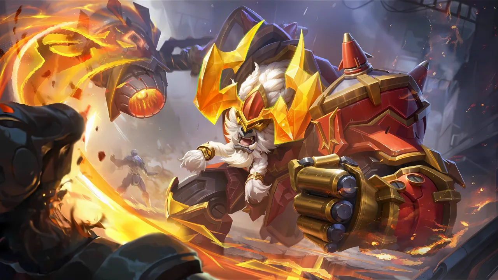

[Скины Минотавра](https://boostmlbb.ru/skins/minotaur.html)

[Скины](https://boostmlbb.ru/skins/)/[Минотавр](https://boostmlbb.ru/skins/minotaur.html)/Дредноут

[Скин Минотавра](https://boostmlbb.ru/skins/minotaur.html)

# Дредноут

Dreadnought

Исключительный ExceptionalОсобыйОграниченный

Как получить

Выходил в магазине обликов во время события. Ограниченные облики иногда возвращаются в розыгрышах событий.

Вышел

20 ноября 2023

## Что меняет облик

-   Новая внешность
-   Новые эффекты навыков
-   Анимация показа
-   Бонус к характеристикам

## Все скины Минотавра [6](https://boostmlbb.ru/skins/minotaur.html)

[Надзи­ратель преис­поднейДелюкс · 2026](https://boostmlbb.ru/skins/minotaur/nether-overseer.html)[ДредноутИсключительный · 2023](https://boostmlbb.ru/skins/minotaur/dreadnought.html)[ТелецДелюкс · 2019](https://boostmlbb.ru/skins/minotaur/taurus.html)[Священный молотОбычный · 2018](https://boostmlbb.ru/skins/minotaur/sacred-hammer.html)[ОрбитерОбычный · 2018](https://boostmlbb.ru/skins/minotaur/orbiter.html)[Неистовый ЯмаОбычный · 2016](https://boostmlbb.ru/skins/minotaur/bursting-yama.html)

## Серия «Особый»

[Тайный вердиктМатильда · 2026](https://boostmlbb.ru/skins/mathilda/arcane-verdict.html)[Вальс на ветруВэйл · 2026](https://boostmlbb.ru/skins/vale/windborne-waltz.html)[Капитан потерянныхФранко · 2026](https://boostmlbb.ru/skins/franco/captain-of-the-lost.html)[ВолнорезЛи Сун-Син · 2025](https://boostmlbb.ru/skins/yi-sun-shin/wavebreaker.html)[Стальные рукиБаданг · 2025](https://boostmlbb.ru/skins/badang/steel-arms.html)[Леди с зонтикомКагура · 2025](https://boostmlbb.ru/skins/kagura/lady-parasol.html)[Ужас пучиныАлдос · 2025](https://boostmlbb.ru/skins/aldous/fathom-terror.html)[Труппа лунного светаЧан'Э · 2025](https://boostmlbb.ru/skins/change/moonglow-troupe.html)

**Сколько стоит буст на герое Минотавр?**Выберите текущий и желаемый ранг. Стоимость появится на сайте.

[Рассчитать цену](https://boostmlbb.ru/order.html?type=hero)

## Частые вопросы

Как получить скин «Дредноут» на Минотавра?

Выходил в магазине обликов во время события. Ограниченные облики иногда возвращаются в розыгрышах событий.

Когда вышел скин «Дредноут»?

20 ноября 2023.

Какой класс у скина «Дредноут»?

Исключительный (Exceptional), серия «Особый».
