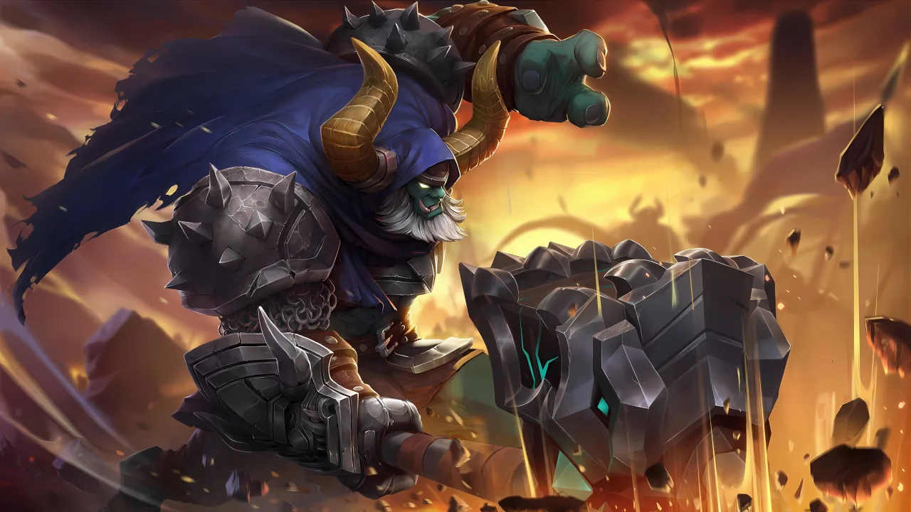

[Тир-лист](https://boostmlbb.ru/heroes/)[Предметы](https://boostmlbb.ru/items/)[Скины](https://boostmlbb.ru/skins/)[Новости и гайды](https://boostmlbb.ru/news/)

[Скины](https://boostmlbb.ru/skins/)/[Минотавр](https://boostmlbb.ru/skins/minotaur.html)/Священный молот

[Скин Минотавра](https://boostmlbb.ru/skins/minotaur.html)

# Священный молот

Sacred Hammer

Обычный CommonЭлитныйВ продаже

Как получить

Продаётся в магазине обликов за 599 алмазов.

Цена

599 алмазов

Вышел

2018 год

## Что меняет облик

-   Новая внешность
-   Другой цвет эффектов
-   Анимация показа
-   Бонус к характеристикам

## Перекраски

Тот же облик в других цветах. Перекраска открывается, только если у вас уже есть сам облик.

-   **Молот отчаяния** Hammer of DespairНаграда «Звёздного участника» в марте 2020.

## Все скины Минотавра [6](https://boostmlbb.ru/skins/minotaur.html)

[Надзи­ратель преис­поднейДелюкс · 2026](https://boostmlbb.ru/skins/minotaur/nether-overseer.html)[ДредноутИсключительный · 2023](https://boostmlbb.ru/skins/minotaur/dreadnought.html)[ТелецДелюкс · 2019](https://boostmlbb.ru/skins/minotaur/taurus.html)[Священный молотОбычный · 2018](https://boostmlbb.ru/skins/minotaur/sacred-hammer.html)[ОрбитерОбычный · 2018](https://boostmlbb.ru/skins/minotaur/orbiter.html)[Неистовый ЯмаОбычный · 2016](https://boostmlbb.ru/skins/minotaur/bursting-yama.html)

## Серия «Элитный»

[Золотой османтусЧан'Э · 2026](https://boostmlbb.ru/skins/change/golden-osmanthus.html)[Король-воена­чальникМартис · 2025](https://boostmlbb.ru/skins/martis/warlord-king.html)[Кадет открытого моряКимми · 2024](https://boostmlbb.ru/skins/kimmy/high-seas-cadet.html)[Зелёная копейщицаСильвана · 2024](https://boostmlbb.ru/skins/silvanna/verdant-lancer.html)[Мародёр Кровавое КопытоХилос · 2024](https://boostmlbb.ru/skins/hylos/bloodhoof-marauder.html)[Изящная бабочкаГвиневра · 2024](https://boostmlbb.ru/skins/guinevere/elegant-butterfly.html)[Маркиз клинковЛанселот · 2024](https://boostmlbb.ru/skins/lancelot/marques-of-blades.html)[Привал в пустошахЧип · 2024](https://boostmlbb.ru/skins/chip/badlands-hiatus.html)

**Поднимем ранг на герое Минотавр**Цена считается в калькуляторе

[Рассчитать цену](https://boostmlbb.ru/order.html?type=hero)

## Частые вопросы

Как получить скин «Священный молот» на Минотавра?

Продаётся в магазине обликов за 599 алмазов.

Когда вышел скин «Священный молот»?

2018 год.

Какой класс у скина «Священный молот»?

Обычный (Common), серия «Элитный».
