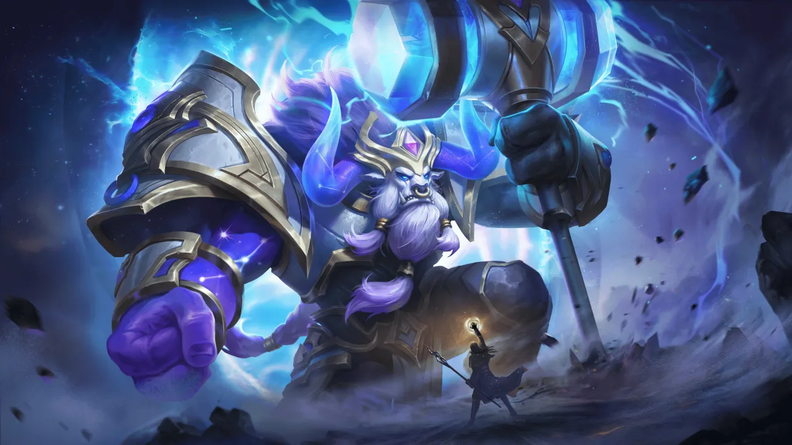

[Скины Минотавра](https://boostmlbb.ru/skins/minotaur.html)

[Скины](https://boostmlbb.ru/skins/)/[Минотавр](https://boostmlbb.ru/skins/minotaur.html)/Телец

[Скин Минотавра](https://boostmlbb.ru/skins/minotaur.html)

# Телец

Taurus

Делюкс DeluxeЗодиакОграниченный

Как получить

Выпадает в розыгрыше «Зодиак» (Zodiac Summon).

Вышел

20 апреля 2019

## Что меняет облик

-   Новая внешность
-   Новые эффекты навыков
-   Звуки навыков
-   Своя озвучка
-   Анимация показа
-   Сцена показа
-   Бонус к характеристикам

## Все скины Минотавра [6](https://boostmlbb.ru/skins/minotaur.html)

[Надзи­ратель преис­поднейДелюкс · 2026](https://boostmlbb.ru/skins/minotaur/nether-overseer.html)[ДредноутИсключительный · 2023](https://boostmlbb.ru/skins/minotaur/dreadnought.html)[ТелецДелюкс · 2019](https://boostmlbb.ru/skins/minotaur/taurus.html)[Священный молотОбычный · 2018](https://boostmlbb.ru/skins/minotaur/sacred-hammer.html)[ОрбитерОбычный · 2018](https://boostmlbb.ru/skins/minotaur/orbiter.html)[Неистовый ЯмаОбычный · 2016](https://boostmlbb.ru/skins/minotaur/bursting-yama.html)

## Серия «Зодиак»

[КозерогМартис · 2022](https://boostmlbb.ru/skins/martis/capricorn.html)[СкорпионХелкарт · 2019](https://boostmlbb.ru/skins/helcurt/scorpio.html)[ВесыЛюнокс · 2019](https://boostmlbb.ru/skins/lunox/libra.html)[ЛевБаданг · 2019](https://boostmlbb.ru/skins/badang/leo.html)[РакЗаск · 2019](https://boostmlbb.ru/skins/zhask/cancer.html)[Близнецы: ТеньСелена · 2019](https://boostmlbb.ru/skins/selena/gemini-shadow.html)[Близнецы: СияниеКарина · 2019](https://boostmlbb.ru/skins/karina/gemini-halo.html)[ОвенХильда · 2019](https://boostmlbb.ru/skins/hilda/aries.html)

**Сколько стоит буст на герое Минотавр?**Выберите текущий и желаемый ранг. Стоимость появится на сайте.

[Рассчитать цену](https://boostmlbb.ru/order.html?type=hero)

## Частые вопросы

Как получить скин «Телец» на Минотавра?

Выпадает в розыгрыше «Зодиак» (Zodiac Summon).

Когда вышел скин «Телец»?

20 апреля 2019.

Какой класс у скина «Телец»?

Делюкс (Deluxe), серия «Зодиак».
