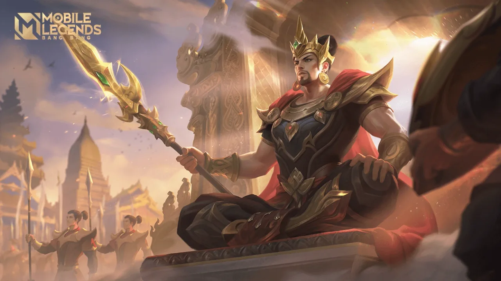

[Тир-лист](https://boostmlbb.ru/heroes/)[Предметы](https://boostmlbb.ru/items/)[Скины](https://boostmlbb.ru/skins/)[Новости и гайды](https://boostmlbb.ru/news/)

[Скины](https://boostmlbb.ru/skins/)/Минситтар

# Скины Минситтара

Скинов

5

Можно купить

2

Последний

[Символ доблести](https://boostmlbb.ru/skins/minsitthar/symbol-of-valor.html)2024

[Профиль героя→](https://boostmlbb.ru/heroes/minsitthar.html)

## Все скины

[Символ доблестиОбычный · 2024](https://boostmlbb.ru/skins/minsitthar/symbol-of-valor.html)[Непобе­димое солнцеИзысканный · 2024](https://boostmlbb.ru/skins/minsitthar/sol-invictus.html)[Боевой левИсключительный · 2023](https://boostmlbb.ru/skins/minsitthar/war-lion.html)[Король войныОбычный · 2022](https://boostmlbb.ru/skins/minsitthar/king-of-war.html)[Позоло­ченный корольОбычный · 2018](https://boostmlbb.ru/skins/minsitthar/gilded-king.html)

**Поднимем ранг на герое Минситтар**Цена считается в калькуляторе

[Рассчитать цену](https://boostmlbb.ru/order.html?type=hero)

## Частые вопросы

Сколько скинов у Минситтара?

5 скинов без стандартного облика. Последний — «Символ доблести» (Symbol of Valor), 21 декабря 2024.

Какие скины Минситтара можно купить сейчас?

«Король войны» (269 алмазов), «Позолоченный король» (599 алмазов). Остальные облики ограниченные и возвращаются только в событиях.

Какой самый редкий скин Минситтара?

«Непобедимое солнце» (Sol Invictus), класс изысканный, серия «Коллекционный». Главный приз розыгрыша в коллекционном событии, попытки покупаются за алмазы. Ограниченные облики иногда возвращаются в розыгрышах событий.
